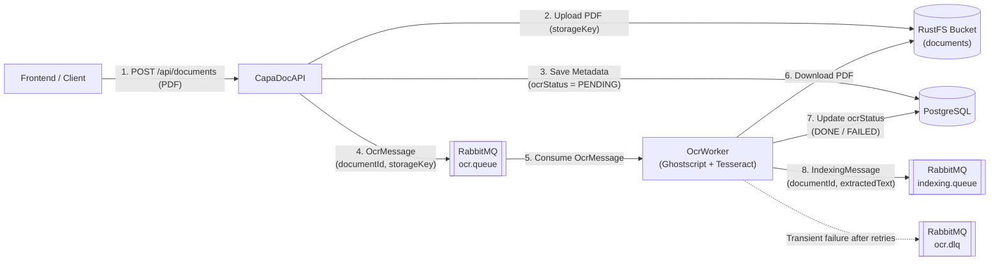

# SWEN3_Capa_Doc

[](https://adoptium.net/)
[](https://spring.io/projects/spring-boot)
[](https://www.postgresql.org/)
[-DEA584.svg?style=flat&logo=rust)](https://rustfs.com/)
[](https://www.docker.com/)
[](https://www.rabbitmq.com/)

A Document Management System (DMS) designed for archiving documents with automated OCR processing, Gen-AI summaries, tagging, and full-text search.

---

## 📋 Features

- 📁 **Document Archiving:** Secure document storage in a dedicated FileStore.
- 🔍 **Automated OCR:** Queue-based optical character recognition for uploaded documents.
- 🤖 **Gen-AI Summaries:** Automatic generation of document summaries using generative AI.
- 🏷️ **Tagging & Full-Text Search:** High-performance search and categorization powered by Elasticsearch.
- ⚡ **RESTful API:** Spring Boot backend with full CRUD support for document metadata.

---

## 🛠️ Tech Stack

| Component | Technology | Version / Details |
| :--- | :--- | :--- |
| **Backend** | Java / Spring Boot | Eclipse Temurin 25 / Spring Boot 4.1.1 |
| **Database** | PostgreSQL | 16-Alpine |
| **Object Storage** | RustFS (S3-compatible) | 1.0.4 (AWS SDK for Java v2) |
| **Message Broker** | RabbitMQ | 3-management-alpine |
| **OCR Engine** | Tesseract OCR & Ghostscript | Local container execution (`deu+eng`, 300 DPI) |
| **Search Engine** | Elasticsearch | *(Planned / In Integration)* |
| **Containerization**| Docker & Docker Compose | Multi-stage build |
| **API Testing** | Bruno | Pre-configured collection |

---
## 🚀 Getting Started

### Prerequisites

- [Docker](https://docs.docker.com/get-docker/) & Docker Compose
- [Bruno](https://www.usebruno.com/) *(optional, recommended for testing API endpoints)*
- Java 25 JDK *(only needed for local, non-containerized builds)*

---

### Run with Docker Compose

1. **Configure Environment Variables**

   Ensure a `.env` file exists in the project root alongside `docker-compose.yaml`:

   ```env
   # PostgreSQL Configuration
   DB_NAME=capadoc_db
   DB_USER=your_user
   DB_PASSWORD=your_password
   ```

2. **Start the Services**

   Build the containers and start services in the background:

   ```bash
   docker compose up -d --build
   ```

   - **Backend API:** Available at `http://localhost:8081`
   - **Frontend UI:** Available at `http://localhost:4200`
   - **PostgreSQL:** Running on port `5432`
   - **RustFS S3 API:** Available on port `9000`
   - **RustFS Web Console:** Available at `http://localhost:9001`
   - **RabbitMQ AMQP:** Available on port `5672`
   - **RabbitMQ Management UI:** Available at `http://localhost:15672`
   - **OCR Worker:** Running as the `ocr-worker` container

3. **Monitor Logs**

   To follow the logs of all containers in real time:

   ```bash
   docker compose logs -f
   ```

   Or follow logs for the API specifically:

   ```bash
   docker compose logs -f api
   ```

4. **Stop the Services**

   To stop and remove containers and networks:

   ```bash
   docker compose down
   ```

   *(Add `-v` to also remove the database volume: `docker compose down -v`)*

---

## 🐇 RabbitMQ and OCR Worker

RabbitMQ decouples document uploads from OCR processing. When the API accepts a
document that requires OCR, it publishes a JSON message to the OCR exchange.
The OCR Worker consumes the message asynchronously, so the API does not have
to wait for OCR processing to finish.

### RabbitMQ setup

RabbitMQ is started by Docker Compose with the `rabbitmq:3-management-alpine`
image. Configure its credentials in the root `.env` file:

```env
RABBITMQ_USER=your_user
RABBITMQ_PASSWORD=your_password
```

The credentials are used by both the API and the OCR Worker. Do not commit
real credentials to the repository.

The RabbitMQ Management UI is available at
[`http://localhost:15672`](http://localhost:15672) after startup. Log in with
the configured `RABBITMQ_USER` and `RABBITMQ_PASSWORD`. The AMQP protocol used
by the Spring Boot services remains available on port `5672`.

### Exchanges, queues, and routing keys

| Resource | Name | Purpose |
| :--- | :--- | :--- |
| OCR exchange | `ocr.exchange` | Direct exchange receiving OCR jobs |
| OCR queue | `ocr.queue` | Durable queue consumed by the OCR Worker |
| OCR routing key | `ocr.routingkey` | Routes messages from the exchange to `ocr.queue` |
| Dead-letter exchange | `ocr.dlx` | Receives rejected or failed OCR messages |
| Dead-letter queue | `ocr.dlq` | Stores messages that could not be processed |
| Dead-letter routing key | `ocr.dlq.routingkey` | Routes messages to `ocr.dlq` |
| Indexing exchange | `indexing.exchange` | Direct exchange receiving extracted OCR text |
| Indexing queue | `indexing.queue` | Durable queue holding `IndexingMessage` payloads for downstream indexing |
| Indexing routing key | `indexing.routingkey` | Routes messages from `indexing.exchange` to `indexing.queue` |

### OCR Pipeline Architecture (`Upload -> RustFS -> OCR-Queue -> OCR-Worker -> Indexing-Queue`)



1. **Upload & Storage:** `CapaDocAPI` accepts a `multipart/form-data` PDF upload, stores the binary in **RustFS** under `documents/<id>/<uuid>-<filename>.pdf`, saves metadata with `ocrStatus = PENDING` in PostgreSQL, and publishes an `OcrMessage` (`documentId`, `storageKey`, `filename`, `contentType`, `uploadedAt`) to `ocr.queue`.
2. **Download & Rasterization (Ghostscript):** `OcrWorker` consumes the message, checks idempotency (skips if `ocrStatus == DONE`), downloads the PDF bytes from RustFS into an isolated temporary directory (`Files.createTempDirectory`), and converts each PDF page to a 24-bit color PNG at configurable DPI using **Ghostscript**:
   ```text
   gs -dNOPAUSE -dBATCH -dSAFER -sDEVICE=png16m -r300 -sOutputFile=<tmp>/page-%03d.png <tmp>/input.pdf
   ```
3. **Text Extraction (Tesseract OCR):** Each rendered page (`page-001.png`, `page-002.png`, ...) is processed in strict page order via **Tesseract**:
   ```text
   tesseract <page.png> stdout -l deu+eng
   ```
   All external processes are invoked via `ProcessBuilder` with an explicit argument list (no shell execution), bounded by a per-page timeout, and the temporary directory is always deleted recursively in a `finally` block.
4. **Status Update & Indexing Queue:** Upon success, `OcrWorker` sets `ocrStatus = DONE` in PostgreSQL and publishes an `IndexingMessage` (`documentId`, `storageKey`, `filename`, `extractedText`, `processedAt`) to `indexing.queue`.
5. **Error Handling:**
   - **Permanent errors** (missing object in RustFS, corrupt/password-protected PDF, page limit exceeded, missing binary): No retry; `ocrStatus` is immediately set to `FAILED`.
   - **Transient errors** (process timeout, temporary S3/network errors): Retried with exponential backoff (`ocr.max-retries`, default `3`). After exhausting retries, `ocrStatus` is set to `FAILED` and the message is published to `ocr.dlq`.

### OCR Configuration (`ocr.*`)

Configure the OCR Worker via environment variables in `.env` (or `OcrWorker/src/main/resources/application.yml`):

| Property | Environment Variable | Default | Description |
| :--- | :--- | :--- | :--- |
| `ocr.languages` | `OCR_LANGUAGES` | `deu+eng` | Tesseract language packs (`deu`, `eng`, `deu+eng`) |
| `ocr.dpi` | `OCR_DPI` | `300` | Ghostscript rasterization resolution in DPI |
| `ocr.timeout-per-page` | `OCR_TIMEOUT_PER_PAGE` | `60s` | Timeout per page / Ghostscript run |
| `ocr.tesseract-command` | `OCR_TESSERACT_COMMAND` | `tesseract` | Path or name of the Tesseract executable |
| `ocr.ghostscript-command` | `OCR_GHOSTSCRIPT_COMMAND` | `gs` | Path or name of the Ghostscript executable |
| `ocr.temp-dir` | `OCR_TEMP_DIR` | `/tmp/capadoc-ocr` | Base directory for temporary OCR working folders |
| `ocr.max-pages` | `OCR_MAX_PAGES` | `200` | Maximum allowed pages per PDF |
| `ocr.max-pdf-size-bytes` | `OCR_MAX_PDF_SIZE_BYTES` | `52428800` (50 MB) | Maximum allowed PDF byte size |

For the component relationships and message flow, see
[`docs/ARCHITECTURE.md`](docs/ARCHITECTURE.md),
[`docs/OCR_WORKER.md`](docs/OCR_WORKER.md),
[`docs/RUSTFS_OBJECT_STORAGE.md`](docs/RUSTFS_OBJECT_STORAGE.md), and
[`docs/OAUTH2_GOOGLE_LOGIN.md`](docs/OAUTH2_GOOGLE_LOGIN.md).

---

## 📡 API Endpoints

Base URL: `http://localhost:8081`

| Method | Endpoint | Description |
| :--- | :--- | :--- |
| `GET` | `/api/ping` | Health check endpoint |
| `GET` | `/api/documents` | Retrieve all documents |
| `GET` | `/api/documents/{id}` | Retrieve a document by ID |
| `GET` | `/api/documents/{id}/download` | Download a PDF document from RustFS |
| `POST` | `/api/documents` | Upload a PDF document (multipart/form-data) |
| `PUT` | `/api/documents/{id}` | Update document metadata |
| `DELETE` | `/api/documents/{id}` | Delete a document from RustFS and PostgreSQL |

---

## 🧪 API Testing with Bruno

A pre-configured Bruno collection is included in the repository.

1. Open the **[Bruno](https://www.usebruno.com/)** desktop application.
2. Select **Open Collection** and choose the directory:
   ```text
   CapaDocAPI/CapaDoc API Bruno
   ```
3. Make sure the services are running via Docker Compose (`http://localhost:8081`).
4. Select the environment or verify that `baseUrl` is set to `http://localhost:8081`.
5. Run the requests (e.g. `Ping`, `01-Documents`) to test the API.

---

## 💻 Local Development (Without Docker for Backend / OCR Worker)

If you prefer to run the Spring Boot API and OCR Worker directly on your host machine:

1. **Start infrastructure services (PostgreSQL, RabbitMQ, RustFS)**:
   ```bash
   docker compose up -d db rabbitmq rustfs
   ```

2. **Run the backend API using the Maven wrapper**:
   ```bash
   cd CapaDocAPI
   ./mvnw spring-boot:run
   ```

3. **Run the OCR Worker locally** *(requires `tesseract-ocr`, `tesseract-ocr-deu`, `tesseract-ocr-eng`, and `ghostscript` installed on the host)*:
   ```bash
   cd OcrWorker
   ./mvnw spring-boot:run
   ```

4. **Run unit & integration tests**:
   ```bash
   cd CapaDocAPI && ./mvnw test
   cd ../OcrWorker && ./mvnw test
   ```
