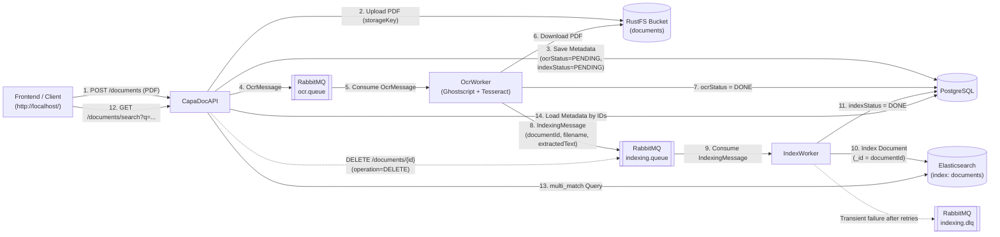

# SWEN3_Capa_Doc

[](https://adoptium.net/)
[](https://spring.io/projects/spring-boot)
[](https://www.postgresql.org/)
[-DEA584.svg?style=flat&logo=rust)](https://rustfs.com/)
[](https://www.elastic.co/elasticsearch)
[](https://www.docker.com/)
[](https://www.rabbitmq.com/)

A Document Management System (DMS) designed for archiving documents with automated OCR processing, Gen-AI summaries, tagging, and full-text search.

---

## 📋 Features

- 📁 **Document Archiving:** Secure document storage in a dedicated FileStore.
- 🔍 **Automated OCR:** Queue-based optical character recognition for uploaded documents.
- 🤖 **Gen-AI Summaries:** Automatic generation of document summaries using generative AI.
- 🏷️ **Tagging & Full-Text Search:** High-performance search and categorization powered by Elasticsearch (`IndexWorker` + `GET /documents/search`).
- ⚡ **RESTful API:** Spring Boot backend with full CRUD support for document metadata.

---

## 🛠️ Tech Stack

| Component | Technology | Version / Details |
| :--- | :--- | :--- |
| **Backend** | Java / Spring Boot | Eclipse Temurin 25 / Spring Boot 4.1.1 |
| **Database** | PostgreSQL | 16-Alpine |
| **Object Storage** | RustFS (S3-compatible) | 1.0.4 (AWS SDK for Java v2) |
| **Message Broker** | RabbitMQ | 3-management-alpine |
| **OCR Engine** | Tesseract OCR & Ghostscript | Local container execution (`deu+eng`, 300 DPI) |
| **Search Engine** | Elasticsearch | 9.4.5 (`co.elastic.clients:elasticsearch-java:9.4.5`) |
| **Indexing Worker** | Spring Boot (`IndexWorker`) | Consumes `indexing.queue`, indexes/deletes in Elasticsearch |
| **Containerization**| Docker & Docker Compose | Multi-stage build |
| **API Testing** | Bruno | Pre-configured collection |

---
## 🚀 Getting Started

### Prerequisites

- [Docker](https://docs.docker.com/get-docker/) & Docker Compose
- [Bruno](https://www.usebruno.com/) *(optional, recommended for testing API endpoints)*
- Java 25 JDK *(only needed for local, non-containerized builds)*

---

### Run with Docker Compose

1. **Configure Environment Variables**

   Ensure a `.env` file exists in the project root alongside `docker-compose.yaml` (see `.env.example`):

   ```env
   # PostgreSQL Configuration
   DB_NAME=capadoc_db
   DB_USER=your_user
   DB_PASSWORD=your_password

   # RabbitMQ Configuration
   RABBITMQ_USER=your_user
   RABBITMQ_PASSWORD=your_password

   # Elasticsearch Configuration
   ELASTICSEARCH_URL=http://elasticsearch:9200
   ELASTICSEARCH_INDEX=documents
   ```

2. **Start the Services**

   Build the containers and start services in the background:

   ```bash
   docker compose up -d --build
   ```

   - **Frontend UI (via nginx):** Available at `http://localhost/` (and `http://localhost:4200`)
   - **Backend API:** Available at `http://localhost:8081`
   - **Elasticsearch:** Available at `http://localhost:9200`
   - **Kibana (optional `tools` profile):** Available at `http://localhost:5601` (`docker compose --profile tools up -d`)
   - **PostgreSQL:** Running on port `5432`
   - **RustFS S3 API:** Available on port `9000`
   - **RustFS Web Console:** Available at `http://localhost:9001`
   - **RabbitMQ AMQP:** Available on port `5672`
   - **RabbitMQ Management UI:** Available at `http://localhost:15672`
   - **OCR Worker:** Running as the `ocr-worker` container
   - **Indexing Worker:** Running as the `index-worker` container

3. **Monitor Logs**

   To follow the logs of all containers in real time:

   ```bash
   docker compose logs -f
   ```

   Or follow logs for the API / Workers specifically:

   ```bash
   docker compose logs -f api ocr-worker index-worker
   ```

4. **Stop the Services**

   To stop and remove containers and networks:

   ```bash
   docker compose down
   ```

   *(Add `-v` to also remove the database and Elasticsearch volumes: `docker compose down -v`)*

---

## 🔄 End-to-End Architecture (`Upload -> RustFS -> OCR-Queue -> OCR-Worker -> Indexing-Queue -> Indexing-Worker -> Elasticsearch -> Suche`)



1. **Upload & Storage (`POST /documents` / `POST /api/documents`):** `CapaDocAPI` validates the uploaded PDF (`application/pdf`, max 10 MB), stores the binary in **RustFS** (`documents/<id>/<uuid>-<filename>.pdf`), saves metadata with `ocrStatus = PENDING` and `indexStatus = PENDING` in **PostgreSQL**, and publishes an `OcrMessage` to `ocr.queue`.
2. **OCR Processing (`OcrWorker`):** `OcrWorker` consumes `OcrMessage`, downloads the PDF from RustFS, converts pages to PNG via **Ghostscript** (`300 DPI`), extracts text via **Tesseract OCR** (`deu+eng`), updates `ocrStatus = DONE` in PostgreSQL, and publishes an `IndexingMessage` (`documentId`, `storageKey`, `filename`, `extractedText`, `processedAt`) to `indexing.queue`.
3. **Indexing (`IndexWorker`):** `IndexWorker` consumes `IndexingMessage` from `indexing.queue`, indexes the document into the **Elasticsearch** index `documents` using `_id = documentId` (ensuring idempotent overwrites on re-indexing), and updates `indexStatus = DONE` in PostgreSQL.
4. **Full-Text Search (`GET /documents/search?q=...&page=0&size=20`):** `CapaDocAPI` executes a case-insensitive `multi_match` query (`fuzziness = AUTO`, fields `filename^2.0` and `content`) with snippet highlighting against Elasticsearch, loads the matching document entities from PostgreSQL, preserves the Elasticsearch relevance order, skips stale IDs that no longer exist in PostgreSQL, and returns `DocumentResponseDTO` items.
5. **Document Deletion (`DELETE /documents/{id}`):** `CapaDocAPI` deletes the PDF from RustFS and the metadata row from PostgreSQL, then publishes an `IndexingDeleteMessage` (`documentId`, `operation = "DELETE"`) to `indexing.queue`. `IndexWorker` removes the document from Elasticsearch idempotently (missing entries are ignored without error).

---

## 🔎 Elasticsearch, Kibana & OpenSearch

### Elasticsearch Configuration (Dev Setup)

Elasticsearch runs in `docker-compose.yaml` using the pinned image `docker.elastic.co/elasticsearch/elasticsearch:9.4.5`, matching the Spring Boot 4.1.1 managed Java API Client (`co.elastic.clients:elasticsearch-java:9.4.5`):

- **Single-Node Mode:** `discovery.type=single-node`
- **Dev-Only Security Deactivation:** `xpack.security.enabled=false` and `xpack.security.http.ssl.enabled=false` are enabled **strictly for local development** so the services and local developers can inspect `http://localhost:9200` without TLS/certificate setup. In production, X-Pack Security (`ELASTICSEARCH_USERNAME` / `ELASTICSEARCH_PASSWORD` + TLS) must be enabled.
- **Memory Limit:** Bounded via `ES_JAVA_OPTS=-Xms512m -Xmx512m`.
- **Persistence:** Named volume `elasticsearch-data` mounted at `/usr/share/elasticsearch/data`.
- **Environment Configuration:** Inside the Docker network, services connect via `ELASTICSEARCH_URL=http://elasticsearch:9200`; for local host execution, `http://localhost:9200` is used.
- **Index Mapping (`documents`):** Automatically and idempotently initialized on startup with fields `documentId` (`keyword`), `filename` (`text` with `keyword` subfield), `content` (`text`), and `uploadedAt` (`date`).

### Host Requirement: `vm.max_map_count`

Elasticsearch requires a virtual memory map count (`vm.max_map_count`) of at least `262144`. If the Elasticsearch container fails to start on Linux (or WSL2) with a `max virtual memory areas vm.max_map_count [...] is too low` error, increase it on the host:

```bash
# Apply immediately until next reboot:
sudo sysctl -w vm.max_map_count=262144

# Persist permanently across reboots:
echo "vm.max_map_count=262144" | sudo tee -a /etc/sysctl.conf
sudo sysctl -p
```

### Optional: Kibana (`tools` Compose Profile)

A matching **Kibana 9.4.5** service (`docker.elastic.co/kibana/kibana:9.4.5`) is configured under the optional Docker Compose profile `tools` on port `5601`. Because it uses a profile, a normal `docker compose up` does not start Kibana unless explicitly requested:

```bash
docker compose --profile tools up -d
```

Once started, Kibana is accessible at [`http://localhost:5601`](http://localhost:5601).

### OpenSearch as an Open-Source Alternative

**OpenSearch** is a community-driven, Apache 2.0-licensed open-source fork of Elasticsearch 7.10.2 and Kibana 7.10.2 (initiated by AWS and partners after Elastic changed its licensing model in 2021). It provides comparable distributed full-text search, Lucene-based indexing, REST APIs, and OpenSearch Dashboards as an alternative to Kibana. In this project, we remain with **Elasticsearch** because Spring Boot 4 natively manages the official `co.elastic.clients:elasticsearch-java` client in its dependency BOM, Elasticsearch 8.16+/9.x once again offers an AGPLv3 open-source licensing option alongside its free Basic tier, and the course specification directly targets Elasticsearch.

---

## 🐇 RabbitMQ, OCR Worker & Indexing Worker

RabbitMQ decouples document uploads from both OCR processing and Elasticsearch indexing.

### RabbitMQ setup

RabbitMQ is started by Docker Compose with the `rabbitmq:3-management-alpine`
image. Configure its credentials in the root `.env` file:

```env
RABBITMQ_USER=your_user
RABBITMQ_PASSWORD=your_password
```

The credentials are used by the API, the OCR Worker, and the Indexing Worker. Do not commit
real credentials to the repository.

The RabbitMQ Management UI is available at
[`http://localhost:15672`](http://localhost:15672) after startup.

### Exchanges, queues, and routing keys

| Resource | Name | Purpose |
| :--- | :--- | :--- |
| OCR exchange | `ocr.exchange` | Direct exchange receiving OCR jobs |
| OCR queue | `ocr.queue` | Durable queue consumed by the OCR Worker |
| OCR routing key | `ocr.routingkey` | Routes messages from the exchange to `ocr.queue` |
| OCR Dead-letter exchange | `ocr.dlx` | Receives rejected or failed OCR messages |
| OCR Dead-letter queue | `ocr.dlq` | Stores OCR messages that could not be processed |
| OCR Dead-letter routing key | `ocr.dlq.routingkey` | Routes messages to `ocr.dlq` |
| Indexing exchange | `indexing.exchange` | Direct exchange receiving extracted OCR text and delete events |
| Indexing queue | `indexing.queue` | Durable queue consumed by `IndexWorker` |
| Indexing routing key | `indexing.routingkey` | Routes messages from `indexing.exchange` to `indexing.queue` |
| Indexing Dead-letter exchange | `indexing.dlx` | Receives exhausted indexing messages after retries |
| Indexing Dead-letter queue | `indexing.dlq` | Stores indexing messages that failed after retries |
| Indexing Dead-letter routing key | `indexing.dlq.routingkey` | Routes failed indexing messages to `indexing.dlq` |

### OCR Configuration (`ocr.*`)

Configure the OCR Worker via environment variables in `.env` (or `OcrWorker/src/main/resources/application.yml`):

| Property | Environment Variable | Default | Description |
| :--- | :--- | :--- | :--- |
| `ocr.languages` | `OCR_LANGUAGES` | `deu+eng` | Tesseract language packs (`deu`, `eng`, `deu+eng`) |
| `ocr.dpi` | `OCR_DPI` | `300` | Ghostscript rasterization resolution in DPI |
| `ocr.timeout-per-page` | `OCR_TIMEOUT_PER_PAGE` | `60s` | Timeout per page / Ghostscript run |
| `ocr.tesseract-command` | `OCR_TESSERACT_COMMAND` | `tesseract` | Path or name of the Tesseract executable |
| `ocr.ghostscript-command` | `OCR_GHOSTSCRIPT_COMMAND` | `gs` | Path or name of the Ghostscript executable |
| `ocr.temp-dir` | `OCR_TEMP_DIR` | `/tmp/capadoc-ocr` | Base directory for temporary OCR working folders |
| `ocr.max-pages` | `OCR_MAX_PAGES` | `200` | Maximum allowed pages per PDF |
| `ocr.max-pdf-size-bytes` | `OCR_MAX_PDF_SIZE_BYTES` | `52428800` (50 MB) | Maximum allowed PDF byte size |

For component relationships and message flow, see
[`docs/ARCHITECTURE.md`](docs/ARCHITECTURE.md),
[`docs/OCR_WORKER.md`](docs/OCR_WORKER.md),
[`docs/RUSTFS_OBJECT_STORAGE.md`](docs/RUSTFS_OBJECT_STORAGE.md), and
[`docs/OAUTH2_GOOGLE_LOGIN.md`](docs/OAUTH2_GOOGLE_LOGIN.md).

---

## 📡 API Endpoints

Base URL: `http://localhost:8081` (also proxied via nginx at `http://localhost/api/...`)

| Method | Endpoint | Description |
| :--- | :--- | :--- |
| `GET` | `/api/ping` | Health check endpoint |
| `GET` | `/api/documents` | Retrieve all documents |
| `GET` | `/api/documents/search?q=...&page=0&size=20` | Full-text search across `filename` and OCR `content` (also mapped at `/documents/search`) |
| `GET` | `/api/documents/{id}` | Retrieve a document by ID |
| `GET` | `/api/documents/{id}/download` | Download a PDF document from RustFS |
| `POST` | `/api/documents` | Upload a PDF document (`multipart/form-data`, also mapped at `/documents`) |
| `PUT` | `/api/documents/{id}` | Update document metadata |
| `DELETE` | `/api/documents/{id}` | Delete a document from RustFS, PostgreSQL, and Elasticsearch (also mapped at `/documents/{id}`) |

---

## 🧪 API Testing with Bruno

A pre-configured Bruno collection is included in the repository:
- `01-Documents/Upload Document PDF.yml` (uploads `HelloWorld.pdf` as multipart/form-data)
- `01-Documents/Search Documents.yml` (`GET /api/documents/search?q=Hello&page=0&size=20`)
- `03-Cleanup/Delete Document.yml` (`DELETE /api/documents/{{documentId}}`)

1. Open the **[Bruno](https://www.usebruno.com/)** desktop application.
2. Select **Open Collection** and choose the directory:
   ```text
   CapaDocAPI/CapaDoc API Bruno
   ```
3. Make sure the services are running via Docker Compose (`http://localhost:8081`).
4. Select the environment or verify that `baseUrl` is set to `http://localhost:8081`.
5. Run the requests to test PDF upload, full-text search, and cleanup.

---

## 💻 Local Development (Without Docker for Backend / Workers)

If you prefer to run the Spring Boot API and Workers directly on your host machine:

1. **Start infrastructure services (PostgreSQL, RabbitMQ, RustFS, Elasticsearch)**:
   ```bash
   docker compose up -d db rabbitmq rustfs elasticsearch
   ```

2. **Run the backend API using the Maven wrapper**:
   ```bash
   cd CapaDocAPI
   ./mvnw spring-boot:run
   ```

3. **Run the OCR Worker locally** *(requires `tesseract-ocr`, `tesseract-ocr-deu`, `tesseract-ocr-eng`, and `ghostscript` installed on the host)*:
   ```bash
   cd OcrWorker
   ./mvnw spring-boot:run
   ```

4. **Run the Indexing Worker locally**:
   ```bash
   cd IndexWorker
   ./mvnw spring-boot:run
   ```

5. **Run unit & integration tests**:
   ```bash
   cd CapaDocAPI && ./mvnw test
   cd ../OcrWorker && ./mvnw test
   cd ../IndexWorker && ./mvnw test
   ```
