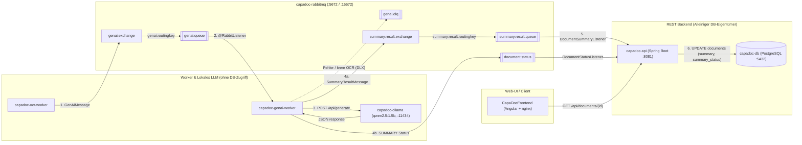
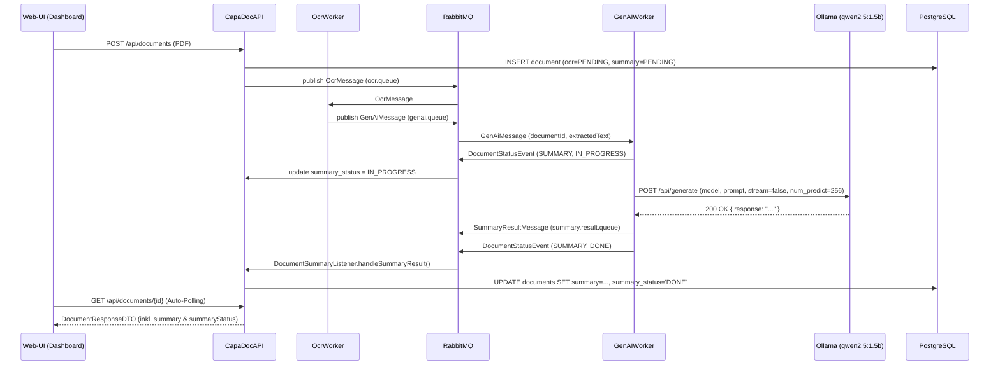
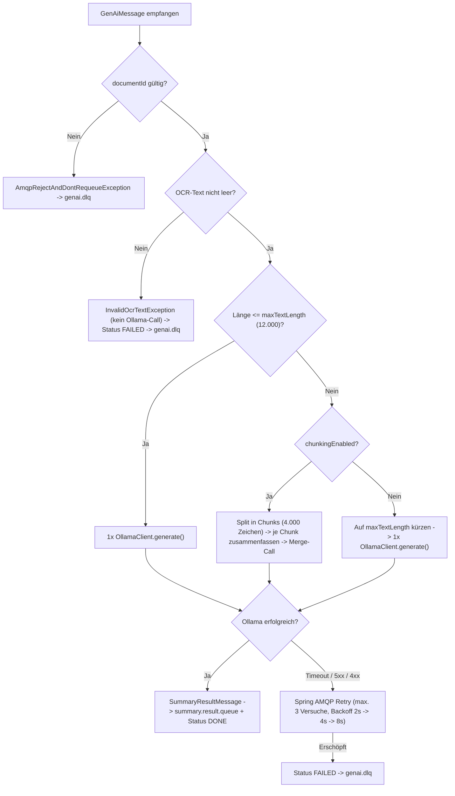

# GenAI-Worker Architektur- & Implementierungs-Dokumentation

Diese Dokumentation beschreibt die Architektur, Konfiguration und Implementierung des **GenAI-Workers (`GenAIWorker`)** im Projekt **CapaDoc**. Der Worker erzeugt automatische Dokumentenzusammenfassungen komplett lokal über **Ollama (CPU-only)** mit dem Modell **`qwen2.5:1.5b`** (ohne externe Cloud-APIs oder API-Keys), kommuniziert asynchron über **RabbitMQ** und besitzt **keinen direkten Datenbankzugriff** auf PostgreSQL.

---

## Inhaltsverzeichnis
1. [Architekturüberblick](#1-architekturüberblick)
2. [Mermaid Ablauf- und Architekturdiagramme](#2-mermaid-ablauf--und-architekturdiagramme)
   - [Komponenten- und Queue-Topologie](#komponenten--und-queue-topologie)
   - [End-to-End Sequenzdiagramm](#end-to-end-sequenzdiagramm)
   - [Langtext-Chunking, Retry & Dead-Letter-Queue](#langtext-chunking-retry--dead-letter-queue)
3. [Containerisierung & Infrastruktur (`Dockerfile` & `docker-compose.yaml`)](#3-containerisierung--infrastruktur-dockerfile--docker-composeyaml)
   - [Ollama & automatischer Modell-Download (`ollama` & `ollama-pull`)](#ollama--automatischer-modell-download-ollama--ollama-pull)
   - [GenAI-Worker Container (`genai-worker`)](#genai-worker-container-genai-worker)
   - [Hinweise zu erstem Start & CPU-Laufzeit](#hinweise-zu-erstem-start--cpu-laufzeit)
4. [Konfiguration (`GenAiProperties` & `RabbitMqConfig`)](#4-konfiguration-genaiproperties--rabbitmqconfig)
   - [Umgebungsvariablen & Defaults (`genai.*`)](#umgebungsvariablen--defaults-genai)
   - [Exchanges, Queues und Nachrichtenformate](#exchanges-queues-und-nachrichtenformate)
5. [Implementierungsdetails](#5-implementierungsdetails)
   - [`OllamaClient` & Schutz vor Endlos-Generierung](#ollamaclient--schutz-vor-endlos-generierung)
   - [`SummaryService`, Prompt-Design & Chunking](#summaryservice-prompt-design--chunking)
   - [`GenAiMessageListener` & `StatusPublisher`](#genaimessagelistener--statuspublisher)
   - [REST-Server Rückkanal (`CapaDocAPI`)](#rest-server-rückkanal-capadocapi)
   - [Web-UI (`CapaDocFrontend`): AI-Status, Detailansicht & ETA-Timer](#web-ui-capadocfrontend-ai-status-detailansicht--eta-timer)
6. [Fehlerbehandlung & Logging](#6-fehlerbehandlung--logging)
7. [Tests & Qualitätssicherung](#7-tests--qualitätssicherung)

---

## 1. Architekturüberblick

Der **GenAI-Worker (`GenAIWorker`)** ist als eigenständige Spring-Boot-Anwendung (Java 25, Spring Boot 4.1.2, Package `capa.genaiworker`) umgesetzt und entkoppelt die rechenintensive LLM-Zusammenfassung vollständig vom REST-Server (`CapaDocAPI`):

1. **Trigger nach OCR (`genai.queue`):** Nach erfolgreicher Texterkennung publiziert der `OcrWorker` neben der `IndexingMessage` eine `GenAiMessage` (`documentId`, `filename`, `extractedText`) an `genai.exchange` → `genai.queue`.
2. **Start-Status (`document.status`):** `GenAiMessageListener` empfängt die Nachricht und meldet über `StatusPublisher` den Status `DocumentStatusEvent(stage=SUMMARY, status=IN_PROGRESS)` an `document.status`.
3. **Zusammenfassung (`SummaryService` → `OllamaClient`):** Der OCR-Text wird validiert, normalisiert und ggf. bei langen Dokumenten in Chunks aufgeteilt. `OllamaClient` ruft `POST {OLLAMA_BASE_URL}/api/generate` mit `model=qwen2.5:1.5b`, `stream=false` und begrenztem Output (`num_predict=256`) auf.
4. **Rückkanal (`summary.result.queue`) & Abschluss-Status (`document.status`):** Die getrimmte Zusammenfassung wird als `SummaryResultMessage(documentId, summary)` an `summary.result.exchange` → `summary.result.queue` gesendet. Anschließend wird `DocumentStatusEvent(stage=SUMMARY, status=DONE)` publiziert.
5. **Persistenz (`CapaDocAPI`):** `DocumentSummaryListener` konsumiert `summary.result.queue` und speichert über `DocumentSummaryServiceImpl` die Spalten `summary` (`TEXT`) sowie `summary_status = DONE` in PostgreSQL. Existiert das Dokument inzwischen nicht mehr, wird die Nachricht sauber mit einer Warnung verworfen.
6. **Anzeige (`CapaDocFrontend`):** Das Dashboard zeigt in der Dokumentenliste das Badge `AI: PENDING | IN_PROGRESS | DONE | FAILED` inkl. dynamischem ETA-Countdown und aktualisiert die Detailansicht automatisch, bis die Zusammenfassung vorliegt.

---

## 2. Mermaid Ablauf- und Architekturdiagramme

### Komponenten- und Queue-Topologie



### End-to-End Sequenzdiagramm



### Langtext-Chunking, Retry & Dead-Letter-Queue



---

## 3. Containerisierung & Infrastruktur (`Dockerfile` & `docker-compose.yaml`)

### Ollama & automatischer Modell-Download (`ollama` & `ollama-pull`)

In [`docker-compose.yaml`](../docker-compose.yaml) laufen zwei Ollama-Services ohne GPU-Abhängigkeit (CPU-only):

- **`ollama` (`capadoc-ollama`):**
  - Image: `ollama/ollama:latest`
  - Port: `11434:11434`
  - Persistentes Volume: `ollama-data:/root/.ollama` (gespeicherte Modelle bleiben zwischen Neustarts erhalten)
  - Healthcheck: `["CMD", "ollama", "list"]` (`interval: 5s`, `timeout: 5s`, `retries: 10`)
  - `restart: unless-stopped`
- **`ollama-pull` (`capadoc-ollama-pull`):**
  - Wartet auf `ollama` (`condition: service_healthy`)
  - Führt einmalig `ollama pull qwen2.5:1.5b` gegen `OLLAMA_HOST=http://ollama:11434` aus (`restart: "no"`).

### GenAI-Worker Container (`genai-worker`)

- **Dockerfile ([`GenAIWorker/Dockerfile`](../GenAIWorker/Dockerfile)):** Multi-Stage-Build mit `eclipse-temurin:25-jdk-noble` (Build) und `eclipse-temurin:25-jre-noble` (Runtime).
- **Startreihenfolge (`depends_on`):** Wartet auf `rabbitmq` (`service_healthy`), `ollama` (`service_healthy`), `ollama-pull` (`service_completed_successfully`) und `api` (`service_started`).
- **Keine Secrets:** Für Ollama und den GenAI-Worker sind keine API-Keys oder externen Zugangsdaten erforderlich.

### Hinweise zu erstem Start & CPU-Laufzeit

- **Erster Start:** Beim allerersten `docker compose up` (oder nach `docker compose down -v`) lädt `ollama-pull` das Modell `qwen2.5:1.5b` (~1 GB) herunter. Der erste Start dauert daher entsprechend länger; bei weiteren Starts wird das Modell aus dem Volume `ollama-data` wiederverwendet.
- **CPU-Inferenzzeit:** Da Ollama rein auf der CPU läuft, dauert eine Zusammenfassung je nach Dokumentenlänge und CPU-Leistung typischerweise **ca. 20 Sekunden bis wenige Minuten** (bei aktivem Chunking für sehr lange Dokumente entsprechend länger).

---

## 4. Konfiguration (`GenAiProperties` & `RabbitMqConfig`)

### Umgebungsvariablen & Defaults (`genai.*`)

Alle Einstellungen besitzen Defaults in [`GenAIWorker/src/main/resources/application.yml`](../GenAIWorker/src/main/resources/application.yml) und sind über `GenAiProperties` (`@ConfigurationProperties(prefix = "genai")`) typsicher gebunden:

| Property | Umgebungsvariable | Default | Beschreibung |
| :--- | :--- | :--- | :--- |
| `genai.ollama.base-url` | `OLLAMA_BASE_URL` | `http://localhost:11434` (`http://ollama:11434` im Profil `docker`) | Basis-URL der Ollama-API |
| `genai.ollama.model` | `OLLAMA_MODEL` | `qwen2.5:1.5b` | Verwendetes Ollama-Modell |
| `genai.ollama.connect-timeout-seconds` | `OLLAMA_CONNECT_TIMEOUT_SECONDS` | `10` | Connect-Timeout in Sekunden |
| `genai.ollama.read-timeout-seconds` | `OLLAMA_TIMEOUT_SECONDS` | `180` | Großzügiges Read-Timeout für CPU-Inferenz in Sekunden |
| `genai.ollama.num-ctx` | `OLLAMA_NUM_CTX` | `4096` | Kontextfenster (`options.num_ctx`) |
| `genai.ollama.num-predict` | `OLLAMA_NUM_PREDICT` | `256` | Maximale Output-Tokens (`options.num_predict`) gegen Endlos-Generierung |
| `genai.ollama.temperature` | `OLLAMA_TEMPERATURE` | `0.2` | Niedrige Temperatur für faktennahe, deterministische Zusammenfassungen |
| `genai.ollama.repeat-penalty` | `OLLAMA_REPEAT_PENALTY` | `1.15` | Wiederholungsstrafe gegen Textschleifen bei kleinen Modellen |
| `genai.max-text-length` | `GENAI_MAX_TEXT_LENGTH` | `12000` | Maximale Zeichenlänge für einen einzelnen Prompt-Aufruf |
| `genai.chunk-size` | `GENAI_CHUNK_SIZE` | `4000` | Zielgröße pro Abschnitt beim Chunking langer Texte |
| `genai.chunking-enabled` | `GENAI_CHUNKING_ENABLED` | `true` | `true`: mehrstufiges Chunking + Merge; `false`: Kürzen auf `max-text-length` |

### Exchanges, Queues und Nachrichtenformate

| Ressource | Name | Zweck |
| :--- | :--- | :--- |
| GenAI Exchange | `genai.exchange` | Direct-Exchange für eingehende GenAI-Aufträge vom `OcrWorker` |
| GenAI Queue | `genai.queue` | Durable Queue mit DLX-Verknüpfung, konsumiert von `GenAIWorker` |
| GenAI Routing Key | `genai.routingkey` | Routing von `genai.exchange` → `genai.queue` |
| GenAI DLX / DLQ | `genai.dlx` / `genai.dlq` (`genai.dlq.routingkey`) | Dead-Letter-Queue für ungültige Nachrichten oder erschöpfte Retries |
| Summary Result Exchange | `summary.result.exchange` | Direct-Exchange für fertige Zusammenfassungen zurück an `CapaDocAPI` |
| Summary Result Queue | `summary.result.queue` | Durable Queue, konsumiert von `DocumentSummaryListener` in `CapaDocAPI` |
| Summary Result Routing Key | `summary.result.routingkey` | Routing von `summary.result.exchange` → `summary.result.queue` |
| Summary Result DLX / DLQ | `summary.result.dlx` / `summary.result.dlq` | Dead-Letter-Queue für ungültige Summary-Payloads |
| Status Exchange / Queue | `document.status.exchange` / `document.status` | Gemeinsamer Status-Kanal für `ProcessingStage.SUMMARY` |

**Nachrichten-DTOs (JSON mit `TypePrecedence.INFERRED` für modulübergreifende Deserialisierung):**
- Auftrag (`GenAiMessage`): `{ "documentId": 2, "filename": "report.pdf", "extractedText": "..." }`
- Ergebnis (`SummaryResultMessage`): `{ "documentId": 2, "summary": "..." }`
- Status (`DocumentStatusEvent`): `{ "documentId": 2, "stage": "SUMMARY", "status": "IN_PROGRESS|DONE|FAILED", "errorMessage": null, "timestamp": "..." }`

---

## 5. Implementierungsdetails

### `OllamaClient` & Schutz vor Endlos-Generierung

[`OllamaClient`](../GenAIWorker/src/main/java/capa/genaiworker/client/OllamaClient.java) nutzt den Spring `RestClient` (konfiguriert mit `SimpleClientHttpRequestFactory` und Connect-/Read-Timeouts in [`RestClientConfig`](../GenAIWorker/src/main/java/capa/genaiworker/config/RestClientConfig.java)) und sendet `POST /api/generate`:

```json
{
  "model": "qwen2.5:1.5b",
  "prompt": "...",
  "stream": false,
  "options": {
    "num_ctx": 4096,
    "num_predict": 256,
    "temperature": 0.2,
    "repeat_penalty": 1.15
  }
}
```

> **Warum `num_predict=256` wichtig ist:** Kleine Modelle wie `qwen2.5:1.5b` können ohne Output-Limit in Wiederholungsschleifen geraten und tausende Tokens generieren. Durch `num_predict=256`, `temperature=0.2` und `repeat_penalty=1.15` bleibt die Antwort kompakt (3–5 Sätze) und terminiert zuverlässig innerhalb von ~20–40 Sekunden auf CPU.

### `SummaryService`, Prompt-Design & Chunking

[`SummaryService`](../GenAIWorker/src/main/java/capa/genaiworker/service/SummaryService.java) kapselt Validierung, Normalisierung, Prompt-Aufbau und Langtext-Behandlung:
- **Prompt-Templates (`GenAiProperties`):** Zentral konfigurierbar (nicht im Code verstreut). Kurze, eindeutige Anweisung für `qwen2.5:1.5b`: 3–5 prägnante Sätze in der Sprache des Dokuments, nur die Zusammenfassung ausgeben, keine Einleitung, nichts erfinden.
- **Lange Texte:** Überschreitet der normalisierte OCR-Text `genai.max-text-length` (`12.000` Zeichen), wird er entlang von Absatz-, Satz- oder Wortgrenzen in Chunks à `4.000` Zeichen zerlegt. Jeder Chunk wird separat zusammengefasst und anschließend über das `mergePromptTemplate` zu einer finalen Zusammenfassung konsolidiert.
- **Nachbearbeitung:** Die Antwort wird getrimmt und auf Nicht-Leerheit geprüft.

### `GenAiMessageListener` & `StatusPublisher`

- [`GenAiMessageListener`](../GenAIWorker/src/main/java/capa/genaiworker/service/GenAiMessageListener.java) konsumiert `genai.queue`, meldet `SUMMARY: IN_PROGRESS`, ruft `SummaryService` auf, publiziert `SummaryResultMessage` an `summary.result.exchange` und meldet `SUMMARY: DONE`.
- [`RabbitMqStatusPublisher`](../GenAIWorker/src/main/java/capa/genaiworker/service/RabbitMqStatusPublisher.java) folgt exakt demselben Muster wie `OcrWorker` und `IndexWorker`.

### REST-Server Rückkanal (`CapaDocAPI`)

- [`DocumentEntity`](../CapaDocAPI/src/main/java/at/capadocapi/model/DocumentEntity.java): erweitert um `summary` (`@Column(name = "summary", columnDefinition = "TEXT")`, nullable) und `summaryStatus` (`ProcessingStatus`, Default `PENDING`). Das Schema wird über Hibernate (`spring.jpa.hibernate.ddl-auto=update`) verwaltet.
- [`DocumentResponseDTO`](../CapaDocAPI/src/main/java/at/capadocapi/model/dto/DocumentResponseDTO.java) & [`DocumentMapper`](../CapaDocAPI/src/main/java/at/capadocapi/mapper/DocumentMapper.java): liefern `summary` und `summaryStatus` in `GET /documents/{id}` bzw. `GET /api/documents/{id}` mit aus.
- [`DocumentSummaryListener`](../CapaDocAPI/src/main/java/at/capadocapi/service/DocumentSummaryListener.java) & [`DocumentSummaryServiceImpl`](../CapaDocAPI/src/main/java/at/capadocapi/service/DocumentSummaryServiceImpl.java): speichern die empfangene Zusammenfassung und setzen `summaryStatus = DONE`. Wurde das Dokument zwischenzeitlich gelöscht, wird die Nachricht mit einer Warnung bestätigt (kein Retry-Loop).

### Web-UI (`CapaDocFrontend`): AI-Status, Detailansicht & ETA-Timer

- **Dashboard-Liste ([`dashboard.html`](../CapaDocFrontend/src/app/pages/dashboard/dashboard.html)):** Zeigt pro Dokument neben `OCR` und `Index` das Badge `AI: PENDING | IN_PROGRESS | DONE | FAILED`. Solange die Zusammenfassung läuft, erscheint ein Live-Countdown (z. B. `AI: IN_PROGRESS · ca. 24s`).
- **Detailansicht:** Zeigt `AI-Summary-Status` sowie eine eigene Sektion **„KI-Zusammenfassung“** (mit Platzhalter *„Zusammenfassung wird erstellt…“* und automatischem Nachladen im Hintergrund alle 5 Sekunden).
- **ETA-Schätzwert-Timer ([`dashboard.ts`](../CapaDocFrontend/src/app/pages/dashboard/dashboard.ts)):**
  - Berechnet aus der Dateigröße eine geschätzte Laufzeit (`25s` Basiszeit + `5s` pro `100 KB`, gedeckelt auf `180s`).
  - Zählt im Sekundentakt ab `uploadedAt` herunter und berücksichtigt bei `PENDING`-Dokumenten die geschätzte Restzeit älterer aktiver/wartender Dokumente in der sequentiellen Ollama-Warteschlange.
  - Fällt bei Überschreitung sauber auf `gleich fertig…` zurück (keine negativen Werte).

---

## 6. Fehlerbehandlung & Logging

- **Eigene Exceptions (`capa.genaiworker.exception`):**
  - `InvalidOcrTextException`: Leerer/ungültiger OCR-Text → **kein** Ollama-Aufruf, Status `FAILED`, sofortiger Reject via `AmqpRejectAndDontRequeueException` → `genai.dlq`.
  - `OllamaUnavailableException`: Timeout, Verbindungsfehler (`ResourceAccessException` / verschachtelte `IOException`), HTTP 5xx → transienter Fehler, Spring AMQP Retry (3 Versuche, Backoff `2s`, Multiplikator `2.0`, max `30s`), nach Erschöpfung → `genai.dlq`.
  - `OllamaResponseException`: HTTP 4xx (inkl. klarer Fehlermeldung bei HTTP 404, wenn das Modell noch nicht geladen ist), ungültiges JSON oder leeres `response`-Feld.
- **Logging (SLF4J):** Alle kritischen Schritte werden mit `documentId` geloggt (Nachricht empfangen, Ollama-Request gesendet, Antwort erhalten inkl. Dauer in ms, Summary gespeichert, Fehler). **Komplette Dokumenttexte werden niemals ins Log geschrieben.**

---

## 7. Tests & Qualitätssicherung

- **GenAIWorker Unit-Tests:**
  - [`OllamaClientTest`](../GenAIWorker/src/test/java/capa/genaiworker/client/OllamaClientTest.java) (`MockRestServiceServer`): Erfolg + JSON-Payload-Prüfung (`num_ctx`, `num_predict`, `temperature`, `repeat_penalty`), Timeout, HTTP 404 (Modell fehlt), HTTP 400, HTTP 500, kaputtes JSON, leere Antwort.
  - [`SummaryServiceTest`](../GenAIWorker/src/test/java/capa/genaiworker/service/SummaryServiceTest.java) (Mockito): Normaler Text, Langtext-Chunking + Merge, Kürzen bei deaktiviertem Chunking, leerer/null Text, Fehlerweiterleitung.
  - [`GenAiMessageListenerTest`](../GenAIWorker/src/test/java/capa/genaiworker/service/GenAiMessageListenerTest.java) (Mockito): Erfolgsfall inkl. Status-Events, ungültige `documentId`, leerer OCR-Text (DLQ ohne Retry), transienter Fehler.
- **CapaDocAPI Unit- & Integrationstests:**
  - [`DocumentSummaryServiceTest`](../CapaDocAPI/src/test/java/at/capadocapi/serviceTests/DocumentSummaryServiceTest.java): Summary speichern + `summaryStatus = DONE`, Dokument nicht gefunden, ungültige Payloads → DLQ.
  - [`DocumentControllerTest`](../CapaDocAPI/src/test/java/at/capadocapi/controllerTest/DocumentControllerTest.java): Prüft, dass `summary` in `GET /documents/{id}` enthalten ist.
  - [`DocumentSummaryIntegrationTest`](../CapaDocAPI/src/test/java/at/capadocapi/integration/DocumentSummaryIntegrationTest.java): End-to-End-Ablauf PDF-Upload → gemockter Ollama-HTTP-Server (klar im Test kommentiert) → Rückkanal-Listener → DB-Persistenz → `GET /documents/{id}` liefert `summary` & `summaryStatus=DONE`.
- **Bruno-Collection:**
  - `01-Documents/Upload Document PDF.yml` → `01-Documents/Get Document by Id.yml` → `01-Documents/Get Document Summary.yml`.
