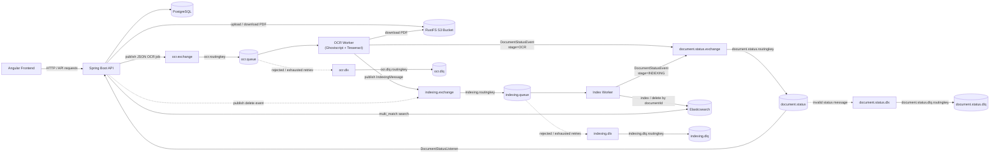

# CapaDoc Architecture

This document describes the runtime architecture of CapaDoc, including the
RabbitMQ-based OCR, Elasticsearch indexing, and asynchronous status reporting
pipelines. Detailed component documentation is available in:
- [Elasticsearch, Indexing-Worker & Full-Text Search](ELASTICSEARCH_INDEXING_AND_SEARCH.md)
- [OCR-Worker (Ghostscript + Tesseract)](OCR_WORKER.md)
- [RustFS Object Storage](RUSTFS_OBJECT_STORAGE.md)
- [OAuth2 & Google Login](OAUTH2_GOOGLE_LOGIN.md)

## System overview

> **Database Access Rule:** Only the Spring Boot REST-Server (`CapaDocAPI`) has a connection to PostgreSQL. All background workers (`OcrWorker`, `IndexWorker`) are stateless with respect to PostgreSQL and report status transitions (`IN_PROGRESS`, `DONE`, `FAILED`) back to `CapaDocAPI` via the `document.status` queue.

## Components

| Component | Responsibility | Docker Compose service |
| :--- | :--- | :--- |
| Angular Frontend | User interface, PDF upload with validation, full-text search UI | `frontend` |
| Spring Boot API | REST API, sole PostgreSQL owner, S3 upload/download, full-text search, status listener | `api` |
| PostgreSQL | Persistent document metadata & processing status (`ocrStatus`, `indexStatus`, `errorMessage`) | `db` |
| RustFS | S3-compatible object storage for PDF binaries (`documents` bucket) | `rustfs` |
| RabbitMQ | Durable message transport and management UI | `rabbitmq` |
| OCR Worker | Downloads PDF from RustFS, runs Ghostscript + Tesseract OCR, publishes to `indexing.queue` and `document.status` | `ocr-worker` |
| Index Worker | Consumes `indexing.queue`, indexes/deletes documents in Elasticsearch, publishes status to `document.status` | `index-worker` |
| Elasticsearch | Single-node full-text search index (`documents`) | `elasticsearch` |
| Kibana *(optional)* | Web UI for inspecting Elasticsearch indices (`--profile tools`) | `kibana` |

## End-to-End Message & Status Flow

1. **Upload:** A PDF document is uploaded through the frontend/API (`POST /api/documents` or `POST /documents`).
2. **Storage & OCR Job:** The API uploads the PDF to RustFS (`documents/<id>.pdf`), saves metadata with `ocrStatus = PENDING` and `indexStatus = PENDING` in PostgreSQL, and publishes an `OcrMessage` (`documentId`, `storageKey`, `filename`, `contentType`, `uploadedAt`) to `ocr.exchange` (`ocr.routingkey` -> `ocr.queue`).
3. **OCR Execution:** The OCR Worker consumes `OcrMessage` from `ocr.queue`, sends `DocumentStatusEvent(stage=OCR, status=IN_PROGRESS)` to `document.status`, downloads the PDF from RustFS, renders pages to PNG via Ghostscript (`gs`), and extracts text page-by-page via Tesseract (`tesseract -l deu+eng`).
4. **Indexing Job & OCR Status:** On success, the OCR Worker **first** publishes `IndexingMessage` (`documentId`, `storageKey`, `filename`, `extractedText`, `uploadedAt`, `processedAt`) to `indexing.exchange` (`indexing.routingkey` -> `indexing.queue`) and **then** publishes `DocumentStatusEvent(stage=OCR, status=DONE)` to `document.status`. On permanent or exhausted transient errors, it publishes `DocumentStatusEvent(stage=OCR, status=FAILED, errorMessage=...)`.
5. **Elasticsearch Indexing & Indexing Status:** The Index Worker consumes `IndexingMessage` from `indexing.queue`, sends `DocumentStatusEvent(stage=INDEXING, status=IN_PROGRESS)` to `document.status`, writes the document to Elasticsearch index `documents` with `_id = documentId`, and **then** sends `DocumentStatusEvent(stage=INDEXING, status=DONE)` to `document.status` (or `FAILED` with `errorMessage` on failure).
6. **Centralized Status Update in REST-Server:** `DocumentStatusListener` in `CapaDocAPI` consumes `document.status` and calls `DocumentStatusServiceImpl.updateDocumentStatus(...)` inside a `@Transactional` boundary. Status updates are idempotent and regression-safe (`DONE` is never overwritten by delayed `IN_PROGRESS` or `FAILED` messages; missing/deleted documents are logged and acknowledged; invalid payloads are routed to `document.status.dlq`).
7. **Full-Text Search & Deletion:** Search runs via `GET /api/documents/search?q=...&page=0&size=20`. On `DELETE /api/documents/{id}`, the API deletes the PDF in RustFS and the row in PostgreSQL, then publishes an `IndexingDeleteMessage` (`operation = "DELETE"`) to `indexing.queue`.
