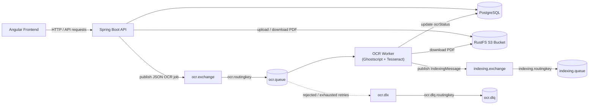

# CapaDoc Architecture

This document describes the runtime architecture of CapaDoc, including the
RabbitMQ-based OCR pipeline. The OAuth2 and BFF authentication design is
documented separately in [OAuth2 & Google Login](OAUTH2_GOOGLE_LOGIN.md).

## System overview

The frontend communicates with the Spring Boot API. The API stores PDF binaries
in RustFS, persists document metadata in PostgreSQL, and publishes OCR jobs to
RabbitMQ when asynchronous text extraction is needed. The OCR Worker consumes
those jobs independently, converts PDF pages to PNGs via Ghostscript, extracts
text via Tesseract OCR, updates `ocrStatus` in PostgreSQL, and publishes the
extracted text to `indexing.queue`.

## Components

| Component | Responsibility | Docker Compose service |
| :--- | :--- | :--- |
| Angular Frontend | User interface and API client | `frontend` |
| Spring Boot API | REST API, document metadata, S3 upload/download, message publisher | `api` |
| PostgreSQL | Persistent document metadata & processing status | `db` |
| RustFS | S3-compatible object storage for PDF binaries (`documents` bucket) | `rustfs` |
| RabbitMQ | Durable message transport and management UI | `rabbitmq` |
| OCR Worker | Downloads PDF from RustFS, runs Ghostscript + Tesseract OCR, publishes to `indexing.queue` | `ocr-worker` |

The API and OCR Worker receive the RabbitMQ host, port, username, and password
through environment variables. Inside the Compose network, both services use
the hostname `rabbitmq`; RabbitMQ itself exposes AMQP on port `5672` and the
browser-facing Management UI on port `15672`.

## OCR message flow

1. A PDF document is uploaded through the frontend/API (`POST /api/documents`).
2. The API uploads the PDF to RustFS (`documents/<id>/<uuid>-<filename>.pdf`), saves metadata with `ocrStatus = PENDING` in PostgreSQL, and publishes an `OcrMessage` (`documentId`, `storageKey`, `filename`, `contentType`, `uploadedAt`) to `ocr.exchange` (`ocr.routingkey` -> `ocr.queue`).
3. The OCR Worker consumes `OcrMessage` from `ocr.queue`, checks idempotency (`ocrStatus == DONE`), downloads the PDF from RustFS, renders pages to PNG via Ghostscript (`gs`), and extracts text page-by-page via Tesseract (`tesseract -l deu+eng`).
4. On success, the OCR Worker sets `ocrStatus = DONE` in PostgreSQL and publishes an `IndexingMessage` (`documentId`, `storageKey`, `filename`, `extractedText`, `processedAt`) to `indexing.exchange` (`indexing.routingkey` -> `indexing.queue`).
5. On permanent errors (missing object in RustFS, invalid/password-protected PDF), the OCR Worker immediately marks `ocrStatus = FAILED` without retrying. On transient errors (timeout, temporary S3 error), it retries with exponential backoff and forwards exhausted messages to `ocr.dlq`.

## Reliability and operations

- The main OCR queue and dead-letter queue are durable.
- The API and Worker use the same exchange, queue, and routing-key names.
- Listener failures are configured with `default-requeue-rejected=false` to
  avoid endless redelivery loops.
- RabbitMQ has a Compose health check, and both API and Worker wait for a
  healthy RabbitMQ service before starting.
- Failed messages can be inspected and managed in the RabbitMQ Management UI
  at `http://localhost:15672`.

The complete queue and credential setup is maintained in the root
[README](../README.md) and the Compose definition
[`docker-compose.yaml`](../docker-compose.yaml).
