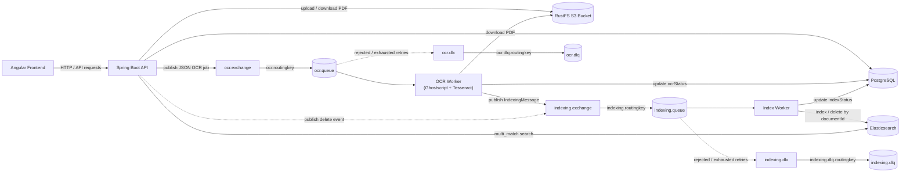

# CapaDoc Architecture

This document describes the runtime architecture of CapaDoc, including the
RabbitMQ-based OCR and Elasticsearch indexing pipelines. The OAuth2 and BFF
authentication design is documented separately in [OAuth2 & Google Login](OAUTH2_GOOGLE_LOGIN.md).

## System overview

The frontend communicates with the Spring Boot API behind nginx (`http://localhost/`).
The API stores PDF binaries in RustFS, persists document metadata in PostgreSQL,
and publishes OCR jobs to RabbitMQ. The OCR Worker converts PDF pages to PNGs via
Ghostscript, extracts text via Tesseract OCR, updates `ocrStatus` in PostgreSQL,
and publishes the extracted text to `indexing.queue`. The Indexing Worker consumes
`indexing.queue`, indexes the document in Elasticsearch (`documents` index, `_id = documentId`),
and sets `indexStatus = DONE` in PostgreSQL.

## Components

| Component | Responsibility | Docker Compose service |
| :--- | :--- | :--- |
| Angular Frontend | User interface, PDF upload with validation, full-text search UI | `frontend` |
| Spring Boot API | REST API, document metadata, S3 upload/download, full-text search, message publisher | `api` |
| PostgreSQL | Persistent document metadata & processing status (`ocrStatus`, `indexStatus`) | `db` |
| RustFS | S3-compatible object storage for PDF binaries (`documents` bucket) | `rustfs` |
| RabbitMQ | Durable message transport and management UI | `rabbitmq` |
| OCR Worker | Downloads PDF from RustFS, runs Ghostscript + Tesseract OCR, publishes to `indexing.queue` | `ocr-worker` |
| Index Worker | Consumes `indexing.queue`, indexes/deletes documents in Elasticsearch, updates `indexStatus` | `index-worker` |
| Elasticsearch | Single-node full-text search index (`documents`) | `elasticsearch` |
| Kibana *(optional)* | Web UI for inspecting Elasticsearch indices (`--profile tools`) | `kibana` |

## End-to-End Message & Search Flow

1. **Upload:** A PDF document is uploaded through the frontend/API (`POST /api/documents` or `POST /documents`).
2. **Storage & OCR Job:** The API uploads the PDF to RustFS (`documents/<id>/<uuid>-<filename>.pdf`), saves metadata with `ocrStatus = PENDING` and `indexStatus = PENDING` in PostgreSQL, and publishes an `OcrMessage` (`documentId`, `storageKey`, `filename`, `contentType`, `uploadedAt`) to `ocr.exchange` (`ocr.routingkey` -> `ocr.queue`).
3. **OCR Execution:** The OCR Worker consumes `OcrMessage` from `ocr.queue`, checks idempotency (`ocrStatus == DONE`), downloads the PDF from RustFS, renders pages to PNG via Ghostscript (`gs`), and extracts text page-by-page via Tesseract (`tesseract -l deu+eng`).
4. **Indexing Job:** On success, the OCR Worker sets `ocrStatus = DONE` in PostgreSQL and publishes an `IndexingMessage` (`documentId`, `storageKey`, `filename`, `extractedText`, `processedAt`) to `indexing.exchange` (`indexing.routingkey` -> `indexing.queue`).
5. **Elasticsearch Indexing:** The Index Worker consumes `IndexingMessage` from `indexing.queue`, resolves `uploadedAt` from PostgreSQL (or message metadata), writes the document to Elasticsearch index `documents` with `_id = documentId`, and sets `indexStatus = DONE` in PostgreSQL.
6. **Full-Text Search:** When a user searches via `GET /api/documents/search?q=...&page=0&size=20`, the API executes a `multi_match` query on `filename` and `content` (`fuzziness = AUTO`) with highlighting, loads matching document entities from PostgreSQL in relevance order, and skips any stale IDs not present in PostgreSQL.
7. **Deletion:** On `DELETE /api/documents/{id}`, the API deletes the PDF in RustFS and the row in PostgreSQL, then publishes an `IndexingDeleteMessage` (`operation = "DELETE"`) to `indexing.queue`. The Index Worker removes the document from Elasticsearch idempotently.

## Reliability and operations

- Both main queues (`ocr.queue`, `indexing.queue`) and dead-letter queues (`ocr.dlq`, `indexing.dlq`) are durable.
- Transient failures in `OcrWorker` and `IndexWorker` are retried with bounded exponential backoff before routing the failed payload to the corresponding DLQ and marking the status as `FAILED`.
- Permanent failures (invalid message payload, missing document ID) are logged without sensitive content, marked `FAILED`, and not retried.
- RabbitMQ and Elasticsearch define Compose health checks; the API and workers wait for healthy dependencies before starting.
