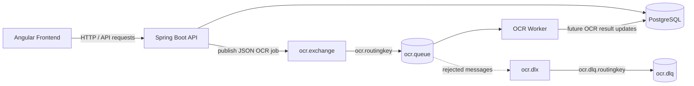

# CapaDoc Architecture

This document describes the runtime architecture of CapaDoc, including the
RabbitMQ-based OCR pipeline. The OAuth2 and BFF authentication design is
documented separately in [OAuth2 & Google Login](OAUTH2_GOOGLE_LOGIN.md).

## System overview

The frontend communicates with the Spring Boot API. The API persists document
metadata in PostgreSQL and publishes OCR jobs to RabbitMQ when asynchronous
text extraction is needed. The OCR Worker consumes those jobs independently.
This keeps document requests responsive and allows worker capacity to be
scaled separately from the API.

## Components

| Component | Responsibility | Docker Compose service |
| :--- | :--- | :--- |
| Angular Frontend | User interface and API client | `frontend` |
| Spring Boot API | REST API, document metadata, message publisher | `api` |
| PostgreSQL | Persistent document metadata | `db` |
| RabbitMQ | Durable message transport and management UI | `rabbitmq` |
| OCR Worker | Consumes OCR jobs and performs OCR processing | `ocr-worker` |

The API and OCR Worker receive the RabbitMQ host, port, username, and password
through environment variables. Inside the Compose network, both services use
the hostname `rabbitmq`; RabbitMQ itself exposes AMQP on port `5672` and the
browser-facing Management UI on port `15672`.

## OCR message flow

1. A document is uploaded through the frontend/API.
2. The API publishes an `OcrMessage` as JSON to the direct exchange
   `ocr.exchange` with routing key `ocr.routingkey`.
3. RabbitMQ routes the message to the durable queue `ocr.queue`.
4. The OCR Worker listens to `ocr.queue`, deserializes the JSON message, and
   processes the document asynchronously.
5. If message processing is rejected, the queue's dead-letter configuration
   routes the message through `ocr.dlx` to `ocr.dlq`.

The current Worker contains the OCR processing integration point and logs the
received document information. The actual OCR implementation can be added
there without changing the API's message-publishing contract.

## Reliability and operations

- The main OCR queue and dead-letter queue are durable.
- The API and Worker use the same exchange, queue, and routing-key names.
- Listener failures are configured with `default-requeue-rejected=false` to
  avoid endless redelivery loops.
- RabbitMQ has a Compose health check, and both API and Worker wait for a
  healthy RabbitMQ service before starting.
- Failed messages can be inspected and managed in the RabbitMQ Management UI
  at `http://localhost:15672`.

The complete queue and credential setup is maintained in the root
[README](../README.md) and the Compose definition
[`docker-compose.yaml`](../docker-compose.yaml).
