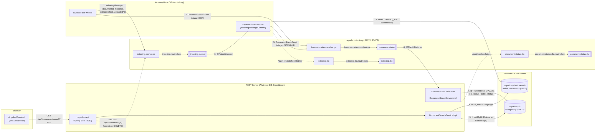
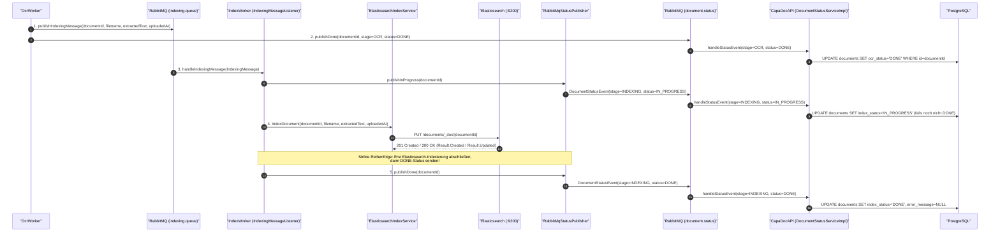
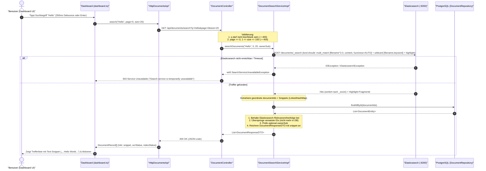
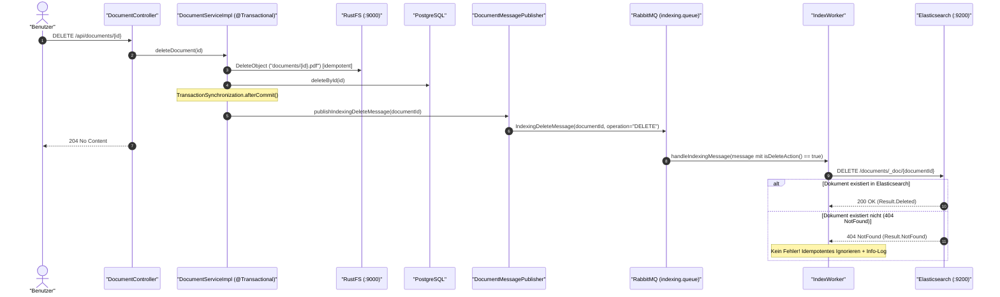
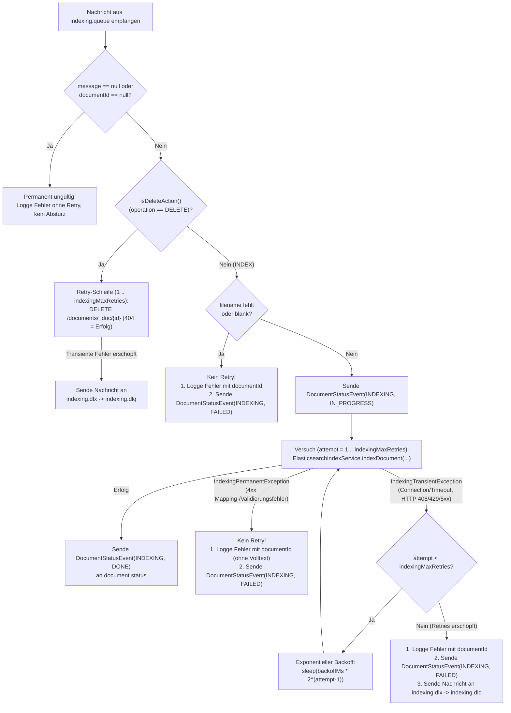

# Elasticsearch, Indexing-Worker & Volltextsuche (REST + UI) Architektur- & Implementierungs-Dokumentation

Diese Dokumentation beschreibt die Architektur, Konfiguration und Implementierung von **Elasticsearch**, dem **Indexing-Worker (`IndexWorker`)**, der **asynchronen Status-Rückmeldung (`document.status`)** sowie der **Volltextsuche im REST-Server (`CapaDocAPI`) und Angular-Frontend (`CapaDocFrontend`)** im Projekt **CapaDoc**.

---

## Inhaltsverzeichnis
1. [Architekturüberblick](#1-architekturüberblick)
2. [Mermaid Ablauf- und Architekturdiagramme](#2-mermaid-ablauf--und-architekturdiagramme)
   - [Komponenten-, Queue- und Such-Topologie](#komponenten--queue--und-such-topologie)
   - [End-to-End Indexing- & Status-Sequenzdiagramm](#end-to-end-indexing---status-sequenzdiagramm)
   - [Volltextsuche-Flow (Angular UI -> REST-Server -> Elasticsearch -> PostgreSQL)](#volltextsuche-flow-angular-ui---rest-server---elasticsearch---postgresql)
   - [Delete-Flow (REST-Server -> Indexing-Queue -> IndexWorker -> Elasticsearch)](#delete-flow-rest-server---indexing-queue---indexworker---elasticsearch)
   - [Fehlerbehandlungs-, Retry- & Dead-Letter-Queue-Fluss](#fehlerbehandlungs--retry---dead-letter-queue-fluss)
3. [Containerisierung & Infrastruktur (`docker-compose.yaml`)](#3-containerisierung--infrastruktur-docker-composeyaml)
   - [Elasticsearch (`elasticsearch:9.4.5`)](#elasticsearch-elasticsearch945)
   - [Optionales Kibana (`--profile tools`) & OpenSearch-Einordnung](#optionales-kibana---profile-tools--opensearch-einordnung)
   - [Docker Compose Integration (`index-worker` ohne Datenbankzugriff)](#docker-compose-integration-index-worker-ohne-datenbankzugriff)
4. [Elasticsearch-Client, Konfiguration & Index-Mapping](#4-elasticsearch-client-konfiguration--index-mapping)
   - [Java API Client (`co.elastic.clients:elasticsearch-java:9.4.5`)](#java-api-client-coelasticclientselasticsearch-java945)
   - [Typsichere `@ConfigurationProperties` (`elasticsearch.*`)](#typsichere-configurationproperties-elasticsearch)
   - [Index-Mapping (`documents`) & idempotente Initialisierung (`ElasticsearchIndexInitializer`)](#index-mapping-documents--idempotente-initialisierung-elasticsearchindexinitializer)
5. [Implementierungsdetails: Indexing-Worker (`IndexWorker`)](#5-implementierungsdetails-indexing-worker-indexworker)
   - [`IndexingMessageListener` & strikte Status-Reihenfolge](#indexingmessagelistener--strikte-status-reihenfolge)
   - [`DocumentIndexService` & `ElasticsearchIndexService` (Idempotenz via `_id = documentId`)](#documentindexservice--elasticsearchindexservice-idempotenz-via-_id--documentid)
   - [Status-Queue statt direktem DB-Zugriff (`StatusPublisher` & `DocumentStatusEvent`)](#status-queue-statt-direktem-db-zugriff-statuspublisher--documentstatusevent)
   - [Zentraler Status-Listener im REST-Server (`DocumentStatusListener` & `DocumentStatusServiceImpl`)](#zentraler-status-listener-im-rest-server-documentstatuslistener--documentstatusserviceimpl)
6. [Implementierungsdetails: Volltextsuche (`CapaDocAPI`)](#6-implementierungsdetails-volltextsuche-capadocapi)
   - [REST-Endpoint (`GET /api/documents/search` & `GET /documents/search`)](#rest-endpoint-get-apidocumentssearch--get-documentssearch)
   - [`DocumentSearchServiceImpl` (`multi_match`, Fuzziness, Highlighting & DB-Abgleich)](#documentsearchserviceimpl-multi_match-fuzziness-highlighting--db-abgleich)
   - [Fehlerbehandlung (`GlobalExceptionHandler`)](#fehlerbehandlung-globalexceptionhandler)
7. [Frontend-Integration (`CapaDocFrontend`)](#7-frontend-integration-capadocfrontend)
   - [API-Client (`DocumentsApi.search` & `HttpDocumentsApi`)](#api-client-documentsapisearch--httpdocumentsapi)
   - [Suchleiste, Debouncing, Snippets & Status-Badges im Dashboard](#suchleiste-debouncing-snippets--status-badges-im-dashboard)
8. [Tests & Qualitätssicherung](#8-tests--qualitätssicherung)

---

## 1. Architekturüberblick

Die Volltextsuche und Dokumentenindexierung in **CapaDoc** basiert auf einer strikt entkoppelten, ereignisgesteuerten Architektur:

1. **Strikte Datenbank-Isolation:** **Ausschließlich der REST-Server (`CapaDocAPI`) besitzt eine Verbindung zu PostgreSQL.** Weder der `OcrWorker` noch der `IndexWorker` enthalten JDBC-/JPA-Abhängigkeiten oder Datenbank-Credentials.
2. **Asynchrone Indexing-Pipeline (`indexing.queue`):** Sobald der `OcrWorker` den Text eines PDFs per Ghostscript und Tesseract extrahiert hat, publiziert er zuerst eine [`IndexingMessage`](file:///home/pascal/Desktop/SWEN3_Capa_Doc/IndexWorker/src/main/java/at/capadoc/indexworker/model/IndexingMessage.java) (`documentId`, `storageKey`, `filename`, `extractedText`, `uploadedAt`, `processedAt`) an `indexing.exchange` -> `indexing.queue` und meldet erst danach `OCR = DONE` über die Queue `document.status`.
3. **Idempotente Elasticsearch-Indexierung (`IndexWorker`):** Der `IndexWorker` konsumiert `IndexingMessage`, sendet `INDEXING = IN_PROGRESS` an `document.status`, speichert das Dokument im Elasticsearch-Index `documents` unter der technischen Dokument-ID `_id = String.valueOf(documentId)` (sodass erneutes Indexieren denselben Eintrag idempotent überschreibt) und sendet **erst nach erfolgreichem Indexieren** `INDEXING = DONE` an `document.status`.
4. **Zentrale Status-Persistenz (`document.status`):** [`DocumentStatusListener`](file:///home/pascal/Desktop/SWEN3_Capa_Doc/CapaDocAPI/src/main/java/at/capadocapi/service/DocumentStatusListener.java) im REST-Server konsumiert die `DocumentStatusEvent`-Nachrichten und aktualisiert `ocrStatus`, `indexStatus` und `errorMessage` transaktional, idempotent und rückschrittsicher in PostgreSQL.
5. **Relevanzbasierte Volltextsuche (`GET /documents/search`):** Der REST-Server durchsucht Elasticsearch per `multi_match` (`filename^2.0`, `content`, `fuzziness = AUTO`) kombiniert mit einem Case-Insensitive-Wildcard auf `filename.keyword` sowie Snippet-Highlighting, lädt die zugehörigen `DocumentEntity`-Datensätze aus PostgreSQL in exakter Relevanz-Reihenfolge und liefert `DocumentResponseDTO`-Objekte inklusive `snippet`, `ocrStatus` und `indexStatus` an das Angular-Frontend.

---

## 2. Mermaid Ablauf- und Architekturdiagramme

### Komponenten-, Queue- und Such-Topologie



---

### End-to-End Indexing- & Status-Sequenzdiagramm



---

### Volltextsuche-Flow (Angular UI -> REST-Server -> Elasticsearch -> PostgreSQL)



---

### Delete-Flow (REST-Server -> Indexing-Queue -> IndexWorker -> Elasticsearch)



---

### Fehlerbehandlungs-, Retry- & Dead-Letter-Queue-Fluss



---

## 3. Containerisierung & Infrastruktur (`docker-compose.yaml`)

### Elasticsearch (`elasticsearch:9.4.5`)

In [`docker-compose.yaml`](file:///home/pascal/Desktop/SWEN3_Capa_Doc/docker-compose.yaml) wird Elasticsearch mit gepinntem Image-Tag `docker.elastic.co/elasticsearch/elasticsearch:9.4.5` betrieben:

| Eigenschaft | Wert | Beschreibung |
| :--- | :--- | :--- |
| **Image** | `docker.elastic.co/elasticsearch/elasticsearch:9.4.5` | Gepinnte stabile Version passend zum Java-Client `9.4.5` |
| **Container-Name** | `capadoc-elasticsearch` | Hostname `elasticsearch` im Docker-Netzwerk (`http://elasticsearch:9200`) |
| **Modus** | `discovery.type=single-node` | Single-Node-Betrieb für lokale Entwicklung und Container-Tests |
| **Dev-Security** | `xpack.security.enabled=false` | **Nur für lokale Entwicklung** deaktiviert (siehe Hinweis in [`README.md`](file:///home/pascal/Desktop/SWEN3_Capa_Doc/README.md)) |
| **Speicherlimit** | `ES_JAVA_OPTS=-Xms512m -Xmx512m` | Begrenzter JVM-Heap (512 MB) |
| **Volume** | `elasticsearch-data:/usr/share/elasticsearch/data` | Persistente Speicherung des Suchindex über Container-Neustarts hinweg |
| **Port** | `9200:9200` | Für lokale Tests und Health-Prüfungen verfügbar |
| **Healthcheck** | `curl -fsS http://localhost:9200/_cluster/health` | `api` und `index-worker` warten per `condition: service_healthy` |

### Optionales Kibana (`--profile tools`) & OpenSearch-Einordnung

* **Kibana (`docker.elastic.co/kibana/kibana:9.4.5`):** Ist in [`docker-compose.yaml`](file:///home/pascal/Desktop/SWEN3_Capa_Doc/docker-compose.yaml) mit dem Compose-Profil `tools` auf Port `5601` konfiguriert. Dadurch startet ein reguläres `docker compose up -d` ohne den zusätzlichen Speicherbedarf von Kibana; bei Bedarf kann Kibana gezielt mit `docker compose --profile tools up -d` hinzugeschaltet werden.
* **OpenSearch-Einordnung:** OpenSearch (Apache-2.0-Fork von Elasticsearch 7.10.2) ist im [`README.md`](file:///home/pascal/Desktop/SWEN3_Capa_Doc/README.md) als Open-Source-Alternative gegenübergestellt. Im Projekt wird Elasticsearch eingesetzt, da Spring Boot 4.1.1 den offiziellen `co.elastic.clients:elasticsearch-java`-Client direkt im Dependency-Management verwaltet.

### Docker Compose Integration (`index-worker` ohne Datenbankzugriff)

* **Multi-Stage Dockerfile ([`IndexWorker/Dockerfile`](file:///home/pascal/Desktop/SWEN3_Capa_Doc/IndexWorker/Dockerfile)):** Baut das Modul mit `eclipse-temurin:25-jdk` und startet das JAR schlank auf `eclipse-temurin:25-jre`.
* **Keine Datenbank-Abhängigkeit:** Der Service `index-worker` in [`docker-compose.yaml`](file:///home/pascal/Desktop/SWEN3_Capa_Doc/docker-compose.yaml) hängt ausschließlich von `rabbitmq` und `elasticsearch` (`condition: service_healthy`) ab und besitzt keinerlei `SPRING_DATASOURCE_*`-Umgebungsvariablen.

---

## 4. Elasticsearch-Client, Konfiguration & Index-Mapping

### Java API Client (`co.elastic.clients:elasticsearch-java:9.4.5`)

Sowohl [`IndexWorker/pom.xml`](file:///home/pascal/Desktop/SWEN3_Capa_Doc/IndexWorker/pom.xml) als auch [`CapaDocAPI/pom.xml`](file:///home/pascal/Desktop/SWEN3_Capa_Doc/CapaDocAPI/pom.xml) nutzen den offiziellen, typsicheren **Elasticsearch Java API Client (`co.elastic.clients:elasticsearch-java`)** zusammen mit `org.elasticsearch.client:elasticsearch-rest-client` und `com.fasterxml.jackson.core:jackson-databind`.

**Grund der Wahl:** Spring Boot 4.1.1 verwaltet `elasticsearch-java:9.4.5` nativ im eigenen BOM, während der Low-Level/Java-API-Client mit Jackson-2-Mapper (`JacksonJsonpMapper`) volle Kontrolle über das Index-Mapping, `multi_match`-Boosts, Wildcards und Highlighting ohne zusätzliche Spring-Data-Abstraktionsprobleme in Spring Boot 4 bietet.

### Typsichere `@ConfigurationProperties` (`elasticsearch.*`)

Beide Module binden die Konfiguration typsicher über `@ConfigurationProperties(prefix = "elasticsearch")` ([`IndexWorker/.../ElasticsearchProperties.java`](file:///home/pascal/Desktop/SWEN3_Capa_Doc/IndexWorker/src/main/java/at/capadoc/indexworker/config/ElasticsearchProperties.java) bzw. [`CapaDocAPI/.../ElasticsearchProperties.java`](file:///home/pascal/Desktop/SWEN3_Capa_Doc/CapaDocAPI/src/main/java/at/capadocapi/config/ElasticsearchProperties.java)):

| Property | ENV-Variable | Default | Beschreibung |
| :--- | :--- | :--- | :--- |
| `elasticsearch.url` | `ELASTICSEARCH_URL` | `http://localhost:9200` (Docker: `http://elasticsearch:9200`) | HTTP-Endpoint des Elasticsearch-Clusters |
| `elasticsearch.index-name` | `ELASTICSEARCH_INDEX` | `documents` | Name des verwendeten Suchindex |
| `elasticsearch.username` | `ELASTICSEARCH_USERNAME` | `""` | Optionaler Benutzername für Basic-Auth |
| `elasticsearch.password` | `ELASTICSEARCH_PASSWORD` | `""` | Optionales Passwort für Basic-Auth |
| `elasticsearch.auto-create-index` | `ELASTICSEARCH_AUTO_CREATE_INDEX` | `true` | Legt den Index `documents` beim Start automatisch an |
| `elasticsearch.max-retries` | `ELASTICSEARCH_MAX_RETRIES` | `10` | Maximale Start-Versuche bei der Index-Initialisierung |
| `elasticsearch.retry-delay-ms` | `ELASTICSEARCH_RETRY_DELAY_MS` | `2000` | Wartezeit (ms) zwischen Initialisierungs-Versuchen |
| `elasticsearch.indexing-max-retries` | `ELASTICSEARCH_INDEXING_MAX_RETRIES` | `3` | Maximale Versuche beim Indexieren/Löschen eines Dokuments |
| `elasticsearch.indexing-retry-backoff-ms` | `ELASTICSEARCH_INDEXING_RETRY_BACKOFF_MS` | `500` | Basis-Backoff (ms) bei transienten Elasticsearch-Fehlern |

### Index-Mapping (`documents`) & idempotente Initialisierung (`ElasticsearchIndexInitializer`)

Beim Anwendungsstart prüft [`ElasticsearchIndexInitializer`](file:///home/pascal/Desktop/SWEN3_Capa_Doc/IndexWorker/src/main/java/at/capadoc/indexworker/config/ElasticsearchIndexInitializer.java) (in `IndexWorker` und analog in [`CapaDocAPI`](file:///home/pascal/Desktop/SWEN3_Capa_Doc/CapaDocAPI/src/main/java/at/capadocapi/config/ElasticsearchIndexInitializer.java)) mit Retry-Mechanismus, ob der Index `documents` existiert, und legt ihn andernfalls idempotent mit folgendem Mapping an (inklusive Behandlung von `resource_already_exists_exception` bei gleichzeitigem Start):

* **`documentId`**: `keyword`
* **`filename`**: `text` mit Unterfeld `filename.keyword` (`keyword`, `ignore_above: 256`)
* **`content`**: `text` (OCR-Volltext)
* **`uploadedAt`**: `date` (ISO-8601 UTC-Zeitstempel)

---

## 5. Implementierungsdetails: Indexing-Worker (`IndexWorker`)

### `IndexingMessageListener` & strikte Status-Reihenfolge

[`IndexingMessageListener`](file:///home/pascal/Desktop/SWEN3_Capa_Doc/IndexWorker/src/main/java/at/capadoc/indexworker/service/IndexingMessageListener.java) konsumiert Nachrichten aus `indexing.queue`:
1. **Validierung:** Fehlt `documentId`, wird der Fehler ohne Retry geloggt. Fehlt bei einer Indexierungs-Nachricht `filename`, wird der Vorgang ohne Retry als `FAILED` über `document.status` gemeldet.
2. **Lösch-Events (`isDeleteAction()`):** Enthält die Nachricht `operation = "DELETE"` (oder `action = "DELETE"`), wird `documentIndexService.deleteDocument(documentId)` mit begrenztem Retry ausgeführt.
3. **Indexierung & strikte Reihenfolge:**
   * Sendet `statusPublisher.publishInProgress(documentId)`.
   * Führt `documentIndexService.indexDocument(documentId, filename, extractedText, uploadedAt)` aus (`uploadedAt` stammt direkt aus der vom `OcrWorker` weitergereichten [`IndexingMessage`](file:///home/pascal/Desktop/SWEN3_Capa_Doc/IndexWorker/src/main/java/at/capadoc/indexworker/model/IndexingMessage.java)).
   * **Erst nach erfolgreichem Indexieren** in Elasticsearch wird `statusPublisher.publishDone(documentId)` aufgerufen.
   * Bei `IndexingTransientException` wird bis zu `indexingMaxRetries` (Default `3`) mit exponentiellem Backoff wiederholt; danach wird `statusPublisher.publishFailed(documentId, errorMessage)` gesendet und die Originalnachricht an `indexing.dlq` weitergeleitet ([`RabbitMqIndexingDeadLetterPublisher`](file:///home/pascal/Desktop/SWEN3_Capa_Doc/IndexWorker/src/main/java/at/capadoc/indexworker/service/RabbitMqIndexingDeadLetterPublisher.java)).
   * Der vollständige Dokumentinhalt (`extractedText`) wird niemals geloggt (nur `documentId`, `filename` und `textLength`).

### `DocumentIndexService` & `ElasticsearchIndexService` (Idempotenz via `_id = documentId`)

In [`ElasticsearchIndexService`](file:///home/pascal/Desktop/SWEN3_Capa_Doc/IndexWorker/src/main/java/at/capadoc/indexworker/service/ElasticsearchIndexService.java):
* **Idempotentes Indexieren:** Verwendet `String.valueOf(documentId)` als Elasticsearch-`_id`. Wird dieselbe Nachricht mehrfach verarbeitet, überschreibt Elasticsearch dasselbe Dokument (`Result.Updated`), ohne Duplikate im Index zu erzeugen.
* **Idempotentes Löschen:** Behandelt sowohl `Result.NotFound` als auch eine `ElasticsearchException` mit HTTP-Status `404` als regulären, fehlerfreien Abschluss.

### Status-Queue statt direktem DB-Zugriff (`StatusPublisher` & `DocumentStatusEvent`)

Sowohl im `OcrWorker` ([`RabbitMqStatusPublisher`](file:///home/pascal/Desktop/SWEN3_Capa_Doc/OcrWorker/src/main/java/at/capadoc/ocrworker/service/RabbitMqStatusPublisher.java)) als auch im `IndexWorker` ([`RabbitMqStatusPublisher`](file:///home/pascal/Desktop/SWEN3_Capa_Doc/IndexWorker/src/main/java/at/capadoc/indexworker/service/RabbitMqStatusPublisher.java)) werden Statusänderungen über `document.status.exchange` -> `document.status` als JSON-Nachricht [`DocumentStatusEvent`](file:///home/pascal/Desktop/SWEN3_Capa_Doc/CapaDocAPI/src/main/java/at/capadocapi/model/dto/DocumentStatusEvent.java) versendet:

```json
{
  "documentId": 42,
  "stage": "INDEXING",
  "status": "DONE",
  "errorMessage": null,
  "timestamp": "2026-11-11T19:45:00"
}
```

### Zentraler Status-Listener im REST-Server (`DocumentStatusListener` & `DocumentStatusServiceImpl`)

* **[`DocumentStatusListener`](file:///home/pascal/Desktop/SWEN3_Capa_Doc/CapaDocAPI/src/main/java/at/capadocapi/service/DocumentStatusListener.java):** Empfängt `DocumentStatusEvent` aus `document.status`. Bei ungültigen Nachrichten (`IllegalArgumentException` oder Deserialisierungsfehlern) wird die Nachricht geloggt und in `document.status.dlq` abgelegt.
* **[`DocumentStatusServiceImpl`](file:///home/pascal/Desktop/SWEN3_Capa_Doc/CapaDocAPI/src/main/java/at/capadocapi/service/DocumentStatusServiceImpl.java) (`@Transactional`):**
  * Lädt `DocumentEntity` per JPA aus PostgreSQL.
  * **Rückschrittsicher:** Steht der Status der betreffenden Stage (`OCR` -> `ocrStatus`, `INDEXING` -> `indexStatus`) bereits auf `DONE`, werden verspätete `IN_PROGRESS`- oder `FAILED`-Events ignoriert.
  * **Idempotent:** Doppelte Events mit identischem Status und `errorMessage` lösen kein erneutes `save(...)` aus.
  * **Gelöschte Dokumente:** Ist `documentId` nicht mehr in PostgreSQL vorhanden, wird eine Warnung geloggt und die Nachricht ohne Fehler bestätigt.

---

## 6. Implementierungsdetails: Volltextsuche (`CapaDocAPI`)

### REST-Endpoint (`GET /api/documents/search` & `GET /documents/search`)

In [`DocumentController`](file:///home/pascal/Desktop/SWEN3_Capa_Doc/CapaDocAPI/src/main/java/at/capadocapi/controller/DocumentController.java) ist der Such-Endpoint unter beiden Pfaden (`/api/documents/search` für den Nginx-Proxy des Frontends und `/documents/search` für direkte REST-Aufrufe) erreichbar:
* **Query-Parameter:**
  * `q`: Suchbegriff (Pflichtfeld; leer oder blank -> `400 Bad Request`)
  * `page`: Seitenindex ab `0` (Default `0`; `< 0` -> `400 Bad Request`)
  * `size`: Seitengröße (Default `20`, max. `100`; `<= 0` oder `> 100` -> `400 Bad Request`)

### `DocumentSearchServiceImpl` (`multi_match`, Fuzziness, Highlighting & DB-Abgleich)

In [`DocumentSearchServiceImpl`](file:///home/pascal/Desktop/SWEN3_Capa_Doc/CapaDocAPI/src/main/java/at/capadocapi/service/DocumentSearchServiceImpl.java):
1. **Bool-Query:** Kombiniert eine `multi_match`-Query (`fields = ["filename^2.0", "content"]`, `fuzziness = "AUTO"`, Case-Insensitive über Standard-Analyzer) mit einer Case-Insensitive-`wildcard`-Query auf `filename.keyword` (`*<query>*`), damit sowohl unscharfe Volltexttreffer im OCR-Text als auch Teilstrings in Dateinamen zuverlässig gefunden werden.
2. **Highlighting:** Fordert für `content` (Fragmentgröße 160 Zeichen) und `filename` Highlight-Snippets an und speichert den besten Treffer-Ausschnitt im Feld `snippet` von [`DocumentResponseDTO`](file:///home/pascal/Desktop/SWEN3_Capa_Doc/CapaDocAPI/src/main/java/at/capadocapi/model/dto/DocumentResponseDTO.java).
3. **Datenbank-Abgleich in Relevanz-Reihenfolge:** Lädt alle gefundenen `documentId`s per `documentRepository.findAllById(...)` aus PostgreSQL, behält die von Elasticsearch gelieferte `_score`-Reihenfolge bei und filtert verwaiste Index-Einträge (die in der DB bereits gelöscht wurden) sauber heraus.

### Fehlerbehandlung (`GlobalExceptionHandler`)

In [`GlobalExceptionHandler`](file:///home/pascal/Desktop/SWEN3_Capa_Doc/CapaDocAPI/src/main/java/at/capadocapi/exception/GlobalExceptionHandler.java):
* Leerer Suchbegriff `q` oder ungültiges `page`/`size` (`IllegalArgumentException`) -> **`400 Bad Request`**
* Elasticsearch nicht erreichbar (`SearchServiceUnavailableException`) -> **`503 Service Unavailable`**

---

## 7. Frontend-Integration (`CapaDocFrontend`)

### API-Client (`DocumentsApi.search` & `HttpDocumentsApi`)

* **[`documents-api.ts`](file:///home/pascal/Desktop/SWEN3_Capa_Doc/CapaDocFrontend/src/app/data/documents-api.ts):** Erweitert `DocumentRecord` um `ocrStatus`, `indexStatus`, `errorMessage` und `snippet` sowie die abstrakte Methode `search(query: string, page?: number, size?: number): Promise<DocumentRecord[]>`.
* **[`http-documents-api.ts`](file:///home/pascal/Desktop/SWEN3_Capa_Doc/CapaDocFrontend/src/app/data/http-documents-api.ts):** Ruft `GET /api/documents/search` mit `HttpParams` (`q`, `page`, `size`) auf.

### Suchleiste, Debouncing, Snippets & Status-Badges im Dashboard

In [`dashboard.ts`](file:///home/pascal/Desktop/SWEN3_Capa_Doc/CapaDocFrontend/src/app/pages/dashboard/dashboard.ts) und [`dashboard.html`](file:///home/pascal/Desktop/SWEN3_Capa_Doc/CapaDocFrontend/src/app/pages/dashboard/dashboard.html):
* **Suchfeld mit Debounce & Enter:** Tippen im Suchfeld löst nach `350 ms` Debounce automatisch die Volltextsuche aus; Absenden per Enter/Button sucht sofort.
* **Zurücksetzen & Leere Eingabe:** Der Button „Zurücksetzen“ (oder das Leeren des Suchfelds) kehrt sofort zur regulären Dokumentenliste zurück; eine leere Suche per Button zeigt einen freundlichen Hinweis an.
* **Ergebnisdarstellung:** Zeigt für jeden Treffer Dateiname, Upload-Datum, Dateigröße, die Status-Badges (`OCR: DONE`, `Index: DONE`), das hervorgehobene Text-Snippet (`document.snippet`) sowie die bestehenden Aktionen (Details öffnen, Download, Löschen).
* **Zustände für „Keine Treffer“ & Fehler:** Eigene UI-Zustände für 0 Treffer (`Keine Treffer für „...“`) sowie bei nicht erreichbarem Suchdienst (`503`) inklusive „Erneut suchen“-Button.

---

## 8. Tests & Qualitätssicherung

* **[`IndexingWorkerTest`](file:///home/pascal/Desktop/SWEN3_Capa_Doc/IndexWorker/src/test/java/at/capadoc/indexworker/service/IndexingWorkerTest.java):** Prüft im `IndexWorker` das erfolgreiche Indexieren inkl. strikter Reihenfolge (`IN_PROGRESS` -> `elasticsearchClient.index` -> `DONE`), die Idempotenz über `_id = documentId` beim Re-Indexieren, das idempotente Löschen (inkl. `Result.NotFound` und HTTP `404`), Retries + `FAILED`-Event + DLQ bei Verbindungsfehlern sowie die Index-Initialisierung (`ElasticsearchIndexInitializer`).
* **[`DocumentStatusServiceTest`](file:///home/pascal/Desktop/SWEN3_Capa_Doc/CapaDocAPI/src/test/java/at/capadocapi/serviceTests/DocumentStatusServiceTest.java):** Prüft im REST-Server `OCR DONE`, `INDEXING DONE`, `FAILED` mit `errorMessage`, Duplikat-Events, Rückschrittsicherheit nach `DONE`, unbekannte `documentId` und die Weiterleitung ungültiger Nachrichten an `document.status.dlq`.
* **[`DocumentSearchServiceTest`](file:///home/pascal/Desktop/SWEN3_Capa_Doc/CapaDocAPI/src/test/java/at/capadocapi/serviceTests/DocumentSearchServiceTest.java) & [`DocumentControllerTest`](file:///home/pascal/Desktop/SWEN3_Capa_Doc/CapaDocAPI/src/test/java/at/capadocapi/controllerTest/DocumentControllerTest.java):** Prüfen Relevanz-Sortierung, Snippet-Extraktion, Ausfiltern gelöschter DB-Einträge, `400 Bad Request` bei leerem `q` oder ungültiger Pagination sowie `503 Service Unavailable` bei Elasticsearch-Ausfall.
