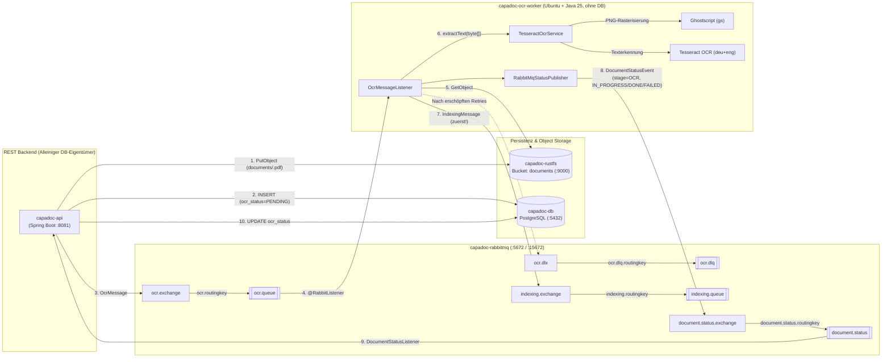
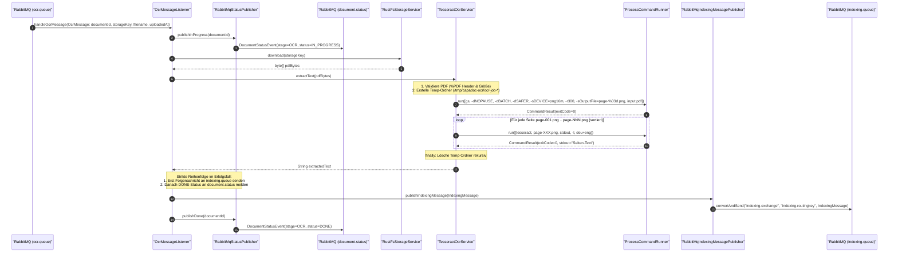
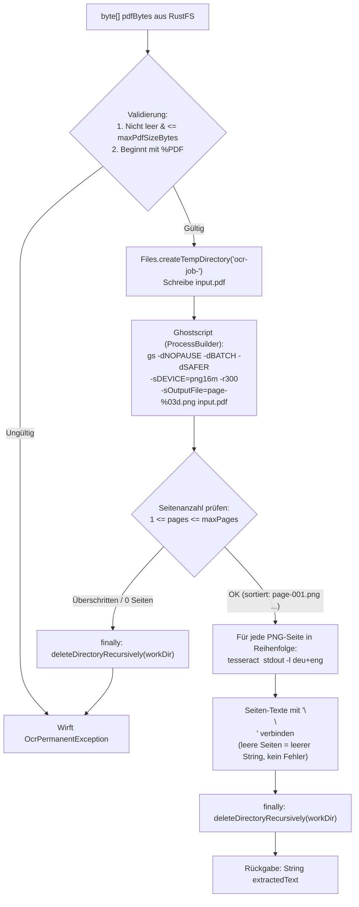
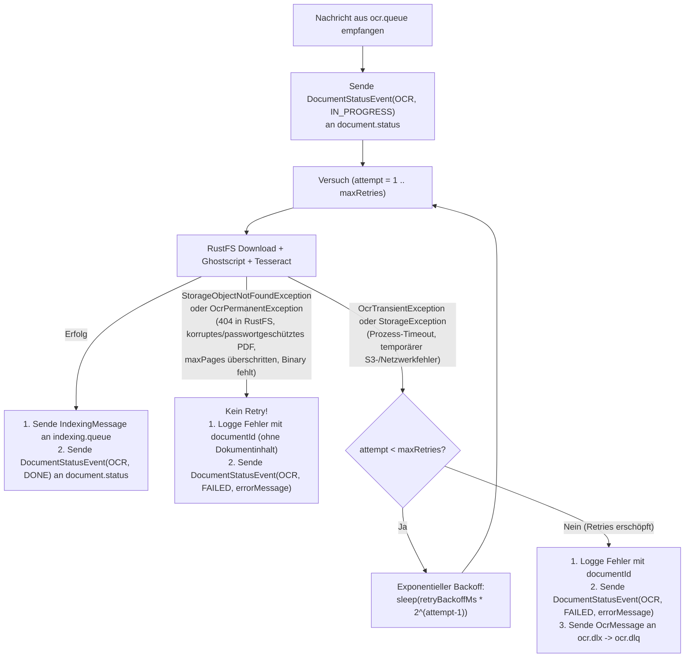

# OCR-Worker Architektur- & Implementierungs-Dokumentation

Diese Dokumentation beschreibt die Architektur, Konfiguration und Implementierung des **OCR-Workers (`OcrWorker`)** im Projekt **CapaDoc** unter Verwendung von **Ghostscript (`gs`)** und **Tesseract OCR (`tesseract`)**, angebunden an **RabbitMQ** und **RustFS** (ohne eigenen Datenbankzugriff; Statusmeldungen erfolgen asynchron über die Queue `document.status` an den REST-Server).

---

## Inhaltsverzeichnis
1. [Architekturüberblick](#1-architekturüberblick)
2. [Mermaid Ablauf- und Architekturdiagramme](#2-mermaid-ablauf--und-architekturdiagramme)
   - [Komponenten- und Queue-Topologie](#komponenten--und-queue-topologie)
   - [End-to-End OCR-Sequenzdiagramm](#end-to-end-ocr-sequenzdiagramm)
   - [Lokale Ghostscript- & Tesseract-Pipeline im Temp-Verzeichnis](#lokale-ghostscript---tesseract-pipeline-im-temp-verzeichnis)
   - [Fehlerbehandlungs-, Retry- & Dead-Letter-Queue-Fluss](#fehlerbehandlungs--retry---dead-letter-queue-fluss)
3. [Containerisierung & Infrastruktur (`Dockerfile` & `docker-compose.yaml`)](#3-containerisierung--infrastruktur-dockerfile--docker-composeyaml)
   - [Multi-Stage Dockerfile (`eclipse-temurin:25-jre-noble`)](#multi-stage-dockerfile-eclipse-temurin25-jre-noble)
   - [Docker Compose Integration (`ocr-worker`)](#docker-compose-integration-ocr-worker)
4. [Konfiguration (`OcrProperties` & `RabbitMqConfig`)](#4-konfiguration-ocrproperties--rabbitmqconfig)
   - [Typsichere OCR-Properties (`ocr.*`)](#typsichere-ocr-properties-ocr)
   - [Exchanges, Queues und Nachrichtenformate](#exchanges-queues-und-nachrichtenformate)
5. [Implementierungsdetails (`OcrWorker`)](#5-implementierungsdetails-ocrworker)
   - [`OcrService` & `TesseractOcrService`](#ocrservice--tesseractocrservice)
   - [`CommandRunner` & `ProcessCommandRunner`](#commandrunner--processcommandrunner)
   - [`OcrMessageListener` & `StatusPublisher`](#ocrmessagelistener--statuspublisher)
   - [Fehlerklassen & Ressourcenlimits](#fehlerklassen--ressourcenlimits)
6. [Tests & Qualitätssicherung](#6-tests--qualitätssicherung)

---

## 1. Architekturüberblick

Der **OCR-Worker (`OcrWorker`)** entkoppelt die rechenintensive Texterkennung vollständig vom REST-Server (`CapaDocAPI`). Der Worker besitzt **keine Datenbankverbindung** zu PostgreSQL; alle OCR-Schritte laufen lokal im Container und Statusänderungen werden über RabbitMQ an den REST-Server gemeldet:

1. **Nachrichtenkonsum (`ocr.queue`):** Nach einem PDF-Upload sendet `CapaDocAPI` (nach erfolgreichem DB-Commit) eine `OcrMessage` (`documentId`, `storageKey`, `filename`, `contentType`, `uploadedAt`) an RabbitMQ.
2. **Start-Status (`document.status`):** `OcrMessageListener` sendet über `StatusPublisher` ein `DocumentStatusEvent(stage=OCR, status=IN_PROGRESS)` an `document.status`.
3. **PDF-Download (`RustFS`):** Über `StorageService.download(storageKey)` lädt der Worker die PDF-Binärdaten aus dem S3-kompatiblen Bucket `documents` (`http://rustfs:9000` im Docker-Netz).
4. **Seiten-Rasterisierung (`Ghostscript`):** In einem isolierten temporären Verzeichnis (`Files.createTempDirectory`) wandelt Ghostscript (`gs`) jede PDF-Seite mit konfigurierbarer Auflösung (Default `300 DPI`) in ein 24-Bit-PNG-Bild (`page-001.png`, `page-002.png`, ...) um.
5. **Texterkennung (`Tesseract OCR`):** Für jedes erzeugte PNG wird `tesseract <page.png> stdout -l deu+eng` in exakter Seitenreihenfolge ausgeführt und der erkannte Text seitenweise zusammengefügt. Das temporäre Verzeichnis wird im `finally`-Block garantiert rekursiv gelöscht.
6. **Weiterleitung (`indexing.queue`) & Abschluss-Status (`document.status`):** Im Erfolgsfall publiziert der Worker **zuerst** die Folgenachricht `IndexingMessage` (`documentId`, `storageKey`, `filename`, `extractedText`, `uploadedAt`, `processedAt`) an `indexing.exchange` -> `indexing.queue` und sendet **erst danach** `DocumentStatusEvent(stage=OCR, status=DONE)` an `document.status`. Bei permanentem Fehler oder erschöpften Retries wird `DocumentStatusEvent(stage=OCR, status=FAILED, errorMessage=...)` gesendet.

---

## 2. Mermaid Ablauf- und Architekturdiagramme

### Komponenten- und Queue-Topologie



---

### End-to-End OCR-Sequenzdiagramm



---

### Lokale Ghostscript- & Tesseract-Pipeline im Temp-Verzeichnis



---

### Fehlerbehandlungs-, Retry- & Dead-Letter-Queue-Fluss



---

## 3. Containerisierung & Infrastruktur (`Dockerfile` & `docker-compose.yaml`)

### Multi-Stage Dockerfile (`eclipse-temurin:25-jre-noble`)

In [`OcrWorker/Dockerfile`](file:///home/pascal/Desktop/SWEN3_Capa_Doc/OcrWorker/Dockerfile) wird ein zweistufiger Build verwendet:
* **Build-Stage (`eclipse-temurin:25-jdk`):** Kompiliert das Maven-Modul und erzeugt das ausführbare Spring-Boot-JAR.
* **Runtime-Stage (`eclipse-temurin:25-jre-noble`):** Basiert auf Ubuntu Noble und installiert die nativen OCR-Werkzeuge:
  ```dockerfile
  RUN apt-get update && \
      apt-get install -y --no-install-recommends \
          tesseract-ocr \
          tesseract-ocr-deu \
          tesseract-ocr-eng \
          ghostscript && \
      rm -rf /var/lib/apt/lists/*
  ```
* Im laufenden Container sind damit `tesseract 5.3.4` (Sprachpakete `deu`, `eng`, `osd`) und `gs 10.02.1` direkt im `PATH` verfügbar.

### Docker Compose Integration (`ocr-worker`)

In [`docker-compose.yaml`](file:///home/pascal/Desktop/SWEN3_Capa_Doc/docker-compose.yaml) ist der Service `ocr-worker` wie folgt eingebunden:
* **`depends_on`:** Wartet ausschließlich auf `rabbitmq` und `rustfs` jeweils mit `condition: service_healthy` (keine Datenbank-Abhängigkeit).
* **Umgebungsvariablen:** Erhält ausschließlich RabbitMQ-, RustFS- und OCR-Einstellungen (`RUSTFS_ENDPOINT: http://rustfs:9000`, `OCR_LANGUAGES: ${OCR_LANGUAGES:-deu+eng}`, `OCR_DPI: ${OCR_DPI:-300}`), jedoch keinerlei `SPRING_DATASOURCE_*`-Variablen.

---

## 4. Konfiguration (`OcrProperties` & `RabbitMqConfig`)

### Typsichere OCR-Properties (`ocr.*`)

Die Klasse [`OcrProperties`](file:///home/pascal/Desktop/SWEN3_Capa_Doc/OcrWorker/src/main/java/at/capadoc/ocrworker/config/OcrProperties.java) (`@ConfigurationProperties(prefix = "ocr")`) bindet alle OCR-Einstellungen aus [`OcrWorker/src/main/resources/application.properties`](file:///home/pascal/Desktop/SWEN3_Capa_Doc/OcrWorker/src/main/resources/application.properties) bzw. Umgebungsvariablen:

| Property | ENV-Variable | Default | Beschreibung |
| :--- | :--- | :--- | :--- |
| `ocr.languages` | `OCR_LANGUAGES` | `deu+eng` | Tesseract-Sprachkombination (`-l`) |
| `ocr.dpi` | `OCR_DPI` | `300` | Auflösung für Ghostscript-Rendering (`-r<dpi>`) |
| `ocr.timeout-per-page` | `OCR_TIMEOUT_PER_PAGE` | `60s` | Maximale Laufzeit pro Prozessaufruf |
| `ocr.tesseract-command` | `OCR_TESSERACT_COMMAND` | `tesseract` | Befehl/Pfad zur Tesseract-Binary |
| `ocr.ghostscript-command` | `OCR_GHOSTSCRIPT_COMMAND` | `gs` | Befehl/Pfad zur Ghostscript-Binary |
| `ocr.temp-dir` | `OCR_TEMP_DIR` | `/tmp/capadoc-ocr` | Basisverzeichnis für temporäre Job-Ordner |
| `ocr.max-pages` | `OCR_MAX_PAGES` | `200` | Maximale Seitenanzahl pro PDF |
| `ocr.max-pdf-size-bytes` | `OCR_MAX_PDF_SIZE_BYTES` | `52428800` (50 MB) | Maximale Dateigröße pro PDF |
| `ocr.max-retries` | `OCR_MAX_RETRIES` | `3` | Maximale Versuche bei transienten Fehlern |
| `ocr.retry-backoff-ms` | `OCR_RETRY_BACKOFF_MS` | `500` | Initiale Wartezeit (ms) für exponentiellen Backoff |

### Exchanges, Queues und Nachrichtenformate

In [`RabbitMqConfig`](file:///home/pascal/Desktop/SWEN3_Capa_Doc/OcrWorker/src/main/java/at/capadoc/ocrworker/config/RabbitMqConfig.java) sind alle benötigten Exchanges, Queues und Bindings deklariert:

* **Eingangs-Nachricht ([`OcrMessage`](file:///home/pascal/Desktop/SWEN3_Capa_Doc/OcrWorker/src/main/java/at/capadoc/ocrworker/model/OcrMessage.java)) aus `ocr.queue`:**
  ```json
  {
    "documentId": 1,
    "storageKey": "documents/1.pdf",
    "filename": "Rechnung.pdf",
    "contentType": "application/pdf",
    "uploadedAt": "2026-11-11T00:10:00"
  }
  ```
* **Ausgangs-Nachricht ([`IndexingMessage`](file:///home/pascal/Desktop/SWEN3_Capa_Doc/OcrWorker/src/main/java/at/capadoc/ocrworker/model/IndexingMessage.java)) an `indexing.queue`:**
  ```json
  {
    "documentId": 1,
    "storageKey": "documents/1.pdf",
    "filename": "Rechnung.pdf",
    "extractedText": "Erkannter Volltext aus allen Seiten...",
    "uploadedAt": "2026-11-11T00:10:00",
    "processedAt": "2026-11-11T00:10:02"
  }
  ```
* **Status-Nachricht ([`DocumentStatusEvent`](file:///home/pascal/Desktop/SWEN3_Capa_Doc/OcrWorker/src/main/java/at/capadoc/ocrworker/model/DocumentStatusEvent.java)) an `document.status`:**
  ```json
  {
    "documentId": 1,
    "stage": "OCR",
    "status": "DONE",
    "errorMessage": null,
    "timestamp": "2026-11-11T00:10:02"
  }
  ```

---

## 5. Implementierungsdetails (`OcrWorker`)

### `OcrService` & `TesseractOcrService`
* **[`OcrService`](file:///home/pascal/Desktop/SWEN3_Capa_Doc/OcrWorker/src/main/java/at/capadoc/ocrworker/service/OcrService.java):** Definiert `String extractText(byte[] pdf)`.
* **[`TesseractOcrService`](file:///home/pascal/Desktop/SWEN3_Capa_Doc/OcrWorker/src/main/java/at/capadoc/ocrworker/service/TesseractOcrService.java):**
  * Prüft vorab PDF-Größe und `%PDF`-Header.
  * Legt pro Aufruf via `Files.createTempDirectory(..., "ocr-job-")` ein eigenes Arbeitsverzeichnis an.
  * Führt Ghostscript aus, sortiert die erzeugten `page-XXX.png`-Dateien lexikographisch nach Dateinamen, prüft `maxPages` und führt anschließend Tesseract pro Seite aus.
  * Seiten ohne erkennbaren Text (z. B. leere Seiten oder reine Trennblätter) liefern einen leeren String ohne Fehler.
  * Löscht das temporäre Arbeitsverzeichnis im `finally`-Block vollständig rekursiv (`deleteDirectoryRecursively`).

### `CommandRunner` & `ProcessCommandRunner`
* **[`CommandRunner`](file:///home/pascal/Desktop/SWEN3_Capa_Doc/OcrWorker/src/main/java/at/capadoc/ocrworker/service/CommandRunner.java) & [`ProcessCommandRunner`](file:///home/pascal/Desktop/SWEN3_Capa_Doc/OcrWorker/src/main/java/at/capadoc/ocrworker/service/ProcessCommandRunner.java):**
  * Kapselt `ProcessBuilder` hinter einem leicht mockbaren Interface.
  * Übergibt Argumente ausschließlich als `List<String>` (kein `sh -c`, Schutz vor Command Injection).
  * Liest `stdout` und `stderr` parallel in separaten Daemon-Threads aus, um Buffer-Deadlocks bei großen Textmengen zu verhindern.
  * Überwacht die Laufzeit via `process.waitFor(timeout.toMillis(), TimeUnit.MILLISECONDS)` und beendet hängende Prozesse zuverlässig mittels `process.destroyForcibly()`.

### `OcrMessageListener` & `StatusPublisher`
* **[`OcrMessageListener`](file:///home/pascal/Desktop/SWEN3_Capa_Doc/OcrWorker/src/main/java/at/capadoc/ocrworker/service/OcrMessageListener.java):** Konsumiert Nachrichten aus `ocr.queue`, koordiniert Download, OCR-Extraktion, Weiterleitung an `indexing.queue` bzw. `ocr.dlq` und Status-Events über `document.status`. Im Erfolgsfall gilt die strikte Reihenfolge: **Erst** `indexingMessagePublisher.publishIndexingMessage(...)`, **dann** `statusPublisher.publishDone(documentId)`.
* **[`StatusPublisher`](file:///home/pascal/Desktop/SWEN3_Capa_Doc/OcrWorker/src/main/java/at/capadoc/ocrworker/service/StatusPublisher.java) & [`RabbitMqStatusPublisher`](file:///home/pascal/Desktop/SWEN3_Capa_Doc/OcrWorker/src/main/java/at/capadoc/ocrworker/service/RabbitMqStatusPublisher.java):** Sendet `DocumentStatusEvent` (`stage = OCR`, `status = IN_PROGRESS | DONE | FAILED`, `errorMessage`, `timestamp`) mit bis zu 3 Retries bei kurzzeitigen Broker-Unterbrechungen an `document.status`.

### Fehlerklassen & Ressourcenlimits
* **[`OcrPermanentException`](file:///home/pascal/Desktop/SWEN3_Capa_Doc/OcrWorker/src/main/java/at/capadoc/ocrworker/exception/OcrPermanentException.java) & [`StorageObjectNotFoundException`](file:///home/pascal/Desktop/SWEN3_Capa_Doc/OcrWorker/src/main/java/at/capadoc/ocrworker/exception/StorageObjectNotFoundException.java):** Kennzeichnen nicht wiederholbare Fehler (fehlendes Objekt in RustFS, ungültiges/passwortgeschütztes PDF, Exit-Code != 0, fehlendes Binary, Überschreitung von `maxPages` oder `maxPdfSizeBytes`).
* **[`OcrTransientException`](file:///home/pascal/Desktop/SWEN3_Capa_Doc/OcrWorker/src/main/java/at/capadoc/ocrworker/exception/OcrTransientException.java) & [`StorageException`](file:///home/pascal/Desktop/SWEN3_Capa_Doc/OcrWorker/src/main/java/at/capadoc/ocrworker/exception/StorageException.java):** Kennzeichnen vorübergehende Fehler (Timeouts, temporäre Netzwerk-/S3-Probleme), die per Backoff wiederholt werden.

---

## 6. Tests & Qualitätssicherung

* **[`TesseractOcrServiceTest`](file:///home/pascal/Desktop/SWEN3_Capa_Doc/OcrWorker/src/test/java/at/capadoc/ocrworker/service/TesseractOcrServiceTest.java):** Unit-Tests mit gemocktem `CommandRunner` für Einzelseite, Mehrseitigkeit in korrekter Reihenfolge, leere Seite, Ghostscript-/Tesseract-Exit-Code != 0, Timeout, Seitenlimit-Überschreitung, ungültigen PDF-Header und garantiertes Aufräumen des Temp-Verzeichnisses.
* **[`OcrMessageListenerTest`](file:///home/pascal/Desktop/SWEN3_Capa_Doc/OcrWorker/src/test/java/at/capadoc/ocrworker/service/OcrMessageListenerTest.java):** Unit-Tests mit gemocktem `StorageService`, `OcrService`, `StatusPublisher` und `IndexingMessagePublisher` für Erfolgsfall (inkl. strikter Reihenfolge `publishIndexingMessage` vor `publishDone`), Fehler beim Senden an `indexing.queue` (kein `DONE`), fehlendes RustFS-Objekt, permanenten OCR-Fehler sowie transienten Fehler mit Retry + `FAILED`-Event + DLQ.
* **[`TesseractOcrIntegrationTest`](file:///home/pascal/Desktop/SWEN3_Capa_Doc/OcrWorker/src/test/java/at/capadoc/ocrworker/service/TesseractOcrIntegrationTest.java):** Integrationstest mit echtem Ghostscript und Tesseract gegen ein generiertes `"Hello World"`-PDF (wird per JUnit `Assumptions.assumeTrue(...)` übersprungen, falls lokal keine passenden Binaries/Sprachdaten installiert sind).
