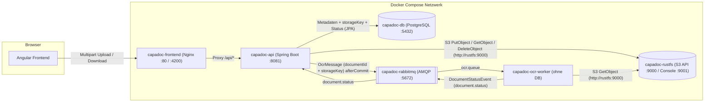
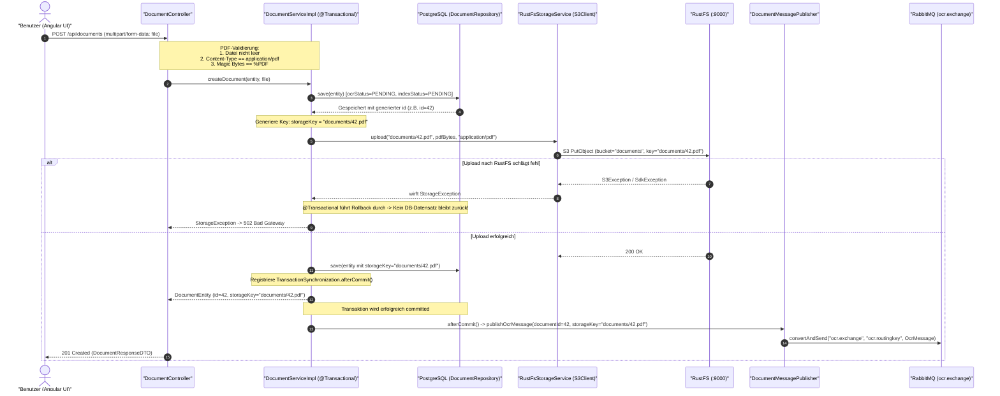
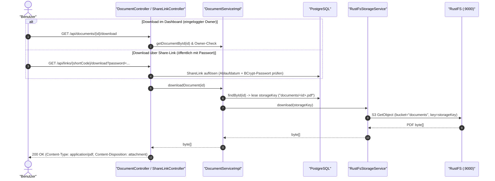
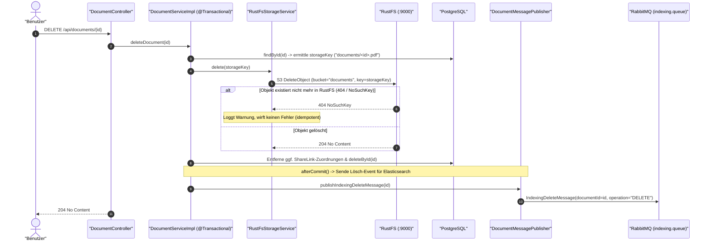

# RustFS Object Storage Architektur- & Implementierungs-Dokumentation

Diese Dokumentation beschreibt die Integration von **RustFS** (S3-kompatibler Open-Source Object Storage) in das Projekt **CapaDoc** (Spring Boot Backend, Angular Frontend, PostgreSQL, RabbitMQ, Elasticsearch).

---

## Inhaltsverzeichnis
1. [Architekturüberblick](#1-architekturüberblick)
2. [Mermaid Ablauf- und Architekturdiagramme](#2-mermaid-ablauf--und-architekturdiagramme)
   - [Komponenten- und Netzwerkarchitektur](#komponenten--und-netzwerkarchitektur)
   - [Upload-Flow (Multipart PDF -> DB -> RustFS -> RabbitMQ)](#upload-flow-multipart-pdf---db---rustfs---rabbitmq)
   - [Download-Flow (Dashboard & Share-Link)](#download-flow-dashboard--share-link)
   - [Delete-Flow (Idempotentes Löschen in RustFS, DB & Elasticsearch)](#delete-flow-idempotentes-löschen-in-rustfs-db--elasticsearch)
3. [Konfiguration & Infrastruktur (Docker Compose & Spring Boot)](#3-konfiguration--infrastruktur-docker-compose--spring-boot)
   - [Docker Compose Setup (`rustfs`)](#docker-compose-setup-rustfs)
   - [Spring Boot Profile & `@ConfigurationProperties`](#spring-boot-profile--configurationproperties)
   - [AWS SDK v2 `S3Client` & automatische Bucket-Initialisierung](#aws-sdk-v2-s3client--automatische-bucket-initialisierung)
4. [Backend-Implementierung (`CapaDocAPI`)](#4-backend-implementierung-capadocapi)
   - [`StorageService` & `RustFsStorageService`](#storageservice--rustfsstorageservice)
   - [Objekt-Key-Schema & Datenmodell (`DocumentEntity`)](#objekt-key-schema--datenmodell-documententity)
   - [PDF-Validierung & Transaktionssicherheit (`DocumentServiceImpl`)](#pdf-validierung--transaktionssicherheit-documentserviceimpl)
   - [Fehlerbehandlung (`GlobalExceptionHandler`)](#fehlerbehandlung-globalexceptionhandler)
5. [Frontend-Integration (`CapaDocFrontend`)](#5-frontend-integration-capadocfrontend)

---

## 1. Architekturüberblick

In **CapaDoc** werden hochgeladene PDF-Dokumente nicht als BLOBs in der relationalen Datenbank abgelegt, sondern in **RustFS** gespeichert:
* **PostgreSQL (`capadoc-db`)** wird **ausschließlich vom REST-Server (`CapaDocAPI`)** angesprochen und speichert die **Metadaten** des Dokuments (`id`, `filename`, `contentType`, `sizeBytes`, `uploadedAt`, `ownerSub`), den Verarbeitungsstatus (`ocrStatus`, `indexStatus`, `errorMessage`) sowie den **Objekt-Key (`storageKey`)** nach dem Schema `documents/<documentId>.pdf`.
* **RustFS (`capadoc-rustfs`)** speichert die eigentlichen PDF-Binärdaten im S3-Bucket `documents` (S3-API auf Port `9000`, Web-Console auf Port `9001`).
* **RabbitMQ (`capadoc-rabbitmq`)** erhält erst **nach erfolgreichem Datenbank-Commit** (`afterCommit`) eine `OcrMessage` mit `documentId` und `storageKey` für die asynchrone Weiterverarbeitung durch den `ocr-worker` (sowie rücklaufende `DocumentStatusEvent`-Nachrichten über `document.status`).

---

## 2. Mermaid Ablauf- und Architekturdiagramme

### Komponenten- und Netzwerkarchitektur

---

### Upload-Flow (Multipart PDF -> DB -> RustFS -> RabbitMQ)

---

### Download-Flow (Dashboard & Share-Link)

---

### Delete-Flow (Idempotentes Löschen in RustFS, DB & Elasticsearch)

---

## 3. Konfiguration & Infrastruktur (Docker Compose & Spring Boot)

### Docker Compose Setup (`rustfs`)

In [`docker-compose.yaml`](file:///home/pascal/Desktop/SWEN3_Capa_Doc/docker-compose.yaml) läuft RustFS mit gepinntem Image-Tag `rustfs/rustfs:1.0.4`, eigenem Named Volume `rustfs-data:/data` und Healthcheck auf Port `9000`:

| Eigenschaft | Wert | Beschreibung |
| :--- | :--- | :--- |
| **Image** | `rustfs/rustfs:1.0.4` | Gepinnte Version (kein `latest`) |
| **Container-Name** | `capadoc-rustfs` | Hostname `rustfs` im Docker-Netzwerk |
| **Ports** | `9000:9000`, `9001:9001` | `9000` = S3-API, `9001` = Web-Console |
| **Volume** | `rustfs-data:/data` | Persistenter Objektspeicher |
| **Healthcheck** | `curl -f http://localhost:9000/health` | Prüft S3-API-Verfügbarkeit; `api` und `ocr-worker` warten via `condition: service_healthy` |
| **Credentials** | `RUSTFS_ACCESS_KEY`, `RUSTFS_SECRET_KEY` | Werden ausschließlich aus `.env` geladen (Vorlage in [`.env.example`](file:///home/pascal/Desktop/SWEN3_Capa_Doc/.env.example)) |

---

### Spring Boot Profile & `@ConfigurationProperties`

Die Konfiguration befindet sich in [`CapaDocAPI/src/main/resources/application.properties`](file:///home/pascal/Desktop/SWEN3_Capa_Doc/CapaDocAPI/src/main/resources/application.properties):
* **Lokal (`default`):** `storage.rustfs.endpoint = ${RUSTFS_ENDPOINT:http://localhost:9000}`
* **Docker:** `RUSTFS_ENDPOINT = http://rustfs:9000`
* **Multipart-Limit:** `spring.servlet.multipart.max-file-size = ${MAX_FILE_SIZE:10MB}`

Gebunden werden diese Werte über die typsichere Klasse [`RustFsProperties`](file:///home/pascal/Desktop/SWEN3_Capa_Doc/CapaDocAPI/src/main/java/at/capadocapi/config/RustFsProperties.java) (`@ConfigurationProperties(prefix = "storage.rustfs")`).

---

### AWS SDK v2 `S3Client` & automatische Bucket-Initialisierung

* **[`RustFsConfig`](file:///home/pascal/Desktop/SWEN3_Capa_Doc/CapaDocAPI/src/main/java/at/capadocapi/config/RustFsConfig.java):** Erstellt die `S3Client`-Bean aus `software.amazon.awssdk:s3` mit:
  * `endpointOverride(URI.create(properties.getEndpoint()))`
  * `forcePathStyle(true)` (wichtig für S3-kompatible Storage-Systeme wie RustFS im Docker-Netz)
  * `StaticCredentialsProvider` mit `AwsBasicCredentials`
  * `Region.of(properties.getRegion())` (Default `us-east-1`)
* **[`RustFsBucketInitializer`](file:///home/pascal/Desktop/SWEN3_Capa_Doc/CapaDocAPI/src/main/java/at/capadocapi/config/RustFsBucketInitializer.java):** Prüft beim Anwendungsstart (`ApplicationRunner`) per `headBucket`, ob der Bucket `documents` existiert, und legt ihn andernfalls per `createBucket` idempotent an. Falls RustFS beim Start noch initialisiert, wird der Vorgang mit konfigurierbaren Retries (`maxRetries`, `retryDelayMs`) wiederholt.

---

## 4. Backend-Implementierung (`CapaDocAPI`)

### `StorageService` & `RustFsStorageService`

* **[`StorageService`](file:///home/pascal/Desktop/SWEN3_Capa_Doc/CapaDocAPI/src/main/java/at/capadocapi/service/Interfaces/StorageService.java):** Definiert die Schnittstelle für Objekt-Operationen:
  * `void upload(String key, byte[] content, String contentType)` (sowie `InputStream`-Überladung)
  * `byte[] download(String key)`
  * `void delete(String key)`
* **[`RustFsStorageService`](file:///home/pascal/Desktop/SWEN3_Capa_Doc/CapaDocAPI/src/main/java/at/capadocapi/service/RustFsStorageService.java):** Implementiert `StorageService` mittels `S3Client`:
  * Wirft [`StorageObjectNotFoundException`](file:///home/pascal/Desktop/SWEN3_Capa_Doc/CapaDocAPI/src/main/java/at/capadocapi/exception/StorageObjectNotFoundException.java), wenn ein angefordertes Objekt beim Download nicht existiert (`NoSuchKeyException` / HTTP `404`).
  * Wirft [`StorageException`](file:///home/pascal/Desktop/SWEN3_Capa_Doc/CapaDocAPI/src/main/java/at/capadocapi/exception/StorageException.java) bei Verbindungs- oder S3-Fehlern.
  * Behandelt fehlende Objekte bei `delete(key)` idempotent und protokolliert eine Warnung.

### Objekt-Key-Schema & Datenmodell (`DocumentEntity`)

* **Objekt-Key-Schema:** `documents/<documentId>.pdf`
* **[`DocumentEntity`](file:///home/pascal/Desktop/SWEN3_Capa_Doc/CapaDocAPI/src/main/java/at/capadocapi/model/DocumentEntity.java)** & **[`DocumentResponseDTO`](file:///home/pascal/Desktop/SWEN3_Capa_Doc/CapaDocAPI/src/main/java/at/capadocapi/model/dto/DocumentResponseDTO.java)** enthalten:
  * `storageKey` (`String`, Spalte `storage_key`)
  * `ocrStatus` ([`ProcessingStatus`](file:///home/pascal/Desktop/SWEN3_Capa_Doc/CapaDocAPI/src/main/java/at/capadocapi/model/ProcessingStatus.java): `PENDING`, `IN_PROGRESS`, `DONE`, `FAILED`, Default `PENDING`)
  * `indexStatus` ([`ProcessingStatus`](file:///home/pascal/Desktop/SWEN3_Capa_Doc/CapaDocAPI/src/main/java/at/capadocapi/model/ProcessingStatus.java): `PENDING`, `IN_PROGRESS`, `DONE`, `FAILED`, Default `PENDING`)
  * `errorMessage` (`String`, Spalte `error_message`, max. 512 Zeichen; wird bei `FAILED`-Events aus der `document.status`-Queue gesetzt)

### PDF-Validierung & Transaktionssicherheit (`DocumentServiceImpl`)

In [`DocumentServiceImpl`](file:///home/pascal/Desktop/SWEN3_Capa_Doc/CapaDocAPI/src/main/java/at/capadocapi/service/DocumentServiceImpl.java):
1. **Validierung (`validateAndReadPdfFile`):** Prüft, dass die Datei nicht leer ist, den Content-Type `application/pdf` besitzt und mit den PDF-Magic-Bytes `%PDF` (`0x25 0x50 0x44 0x46`) beginnt.
2. **Transaktions-Rollback & Cleanup:** Schlägt der Upload nach RustFS fehl, rollt `@Transactional` den zuvor angelegten DB-Eintrag automatisch zurück. Schlägt das anschließende Speichern des `storageKey` in der DB fehl, wird das bereits hochgeladene Objekt in RustFS wieder gelöscht.
3. **Nachrichtenversand nach Commit:** Über `TransactionSynchronizationManager.registerSynchronization` wird `messagePublisher.publishOcrMessage(ocrMessage)` erst in `afterCommit()` aufgerufen, sodass der OCR-Worker niemals eine Nachricht für eine noch nicht committete Transaktion oder ein noch nicht hochgeladenes PDF erhält.

### Fehlerbehandlung (`GlobalExceptionHandler`)

In [`GlobalExceptionHandler`](file:///home/pascal/Desktop/SWEN3_Capa_Doc/CapaDocAPI/src/main/java/at/capadocapi/exception/GlobalExceptionHandler.java):
* `StorageObjectNotFoundException` -> **`404 Not Found`**
* `StorageException` -> **`502 Bad Gateway`**
* `MaxUploadSizeExceededException` -> **`413 Content Too Large`**
* Ungültige PDF-Datei (`IllegalArgumentException` / `MissingServletRequestPartException`) -> **`400 Bad Request`**

---

## 5. Frontend-Integration (`CapaDocFrontend`)

* **Upload ([`upload-page.ts`](file:///home/pascal/Desktop/SWEN3_Capa_Doc/CapaDocFrontend/src/app/pages/upload-page/upload-page.ts), [`http-documents-api.ts`](file:///home/pascal/Desktop/SWEN3_Capa_Doc/CapaDocFrontend/src/app/data/http-documents-api.ts)):** Sendet ausgewählte PDF-Dateien als `FormData` (`multipart/form-data`) an `POST /api/documents`.
* **Dashboard & Details ([`dashboard.ts`](file:///home/pascal/Desktop/SWEN3_Capa_Doc/CapaDocFrontend/src/app/pages/dashboard/dashboard.ts), [`dashboard.html`](file:///home/pascal/Desktop/SWEN3_Capa_Doc/CapaDocFrontend/src/app/pages/dashboard/dashboard.html)):**
  * Zeigt `Storage-Key`, `OCR-Status` und `Index-Status` in den Dokumentdetails an.
  * Bietet Volltextsuche (`GET /api/documents/search`), direkten PDF-Download (`GET /api/documents/{id}/download`), Umbenennen (`PUT /api/documents/{id}`), Share-Link-Verwaltung und Löschen (`DELETE /api/documents/{id}`).
* **Share-Seite ([`share-page.ts`](file:///home/pascal/Desktop/SWEN3_Capa_Doc/CapaDocFrontend/src/app/pages/share-page/share-page.ts)):** Erlaubt nach Passwortprüfung das direkte Herunterladen der geteilten PDF aus RustFS über `GET /api/links/{shortCode}/download?password=...`.
